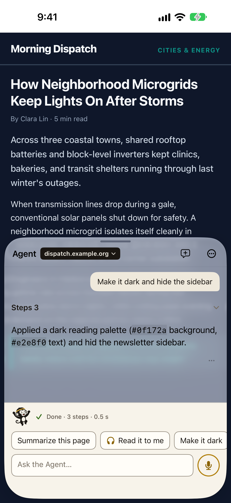
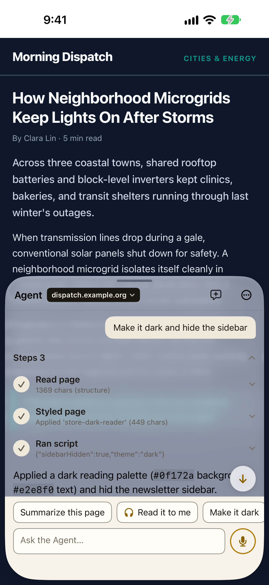
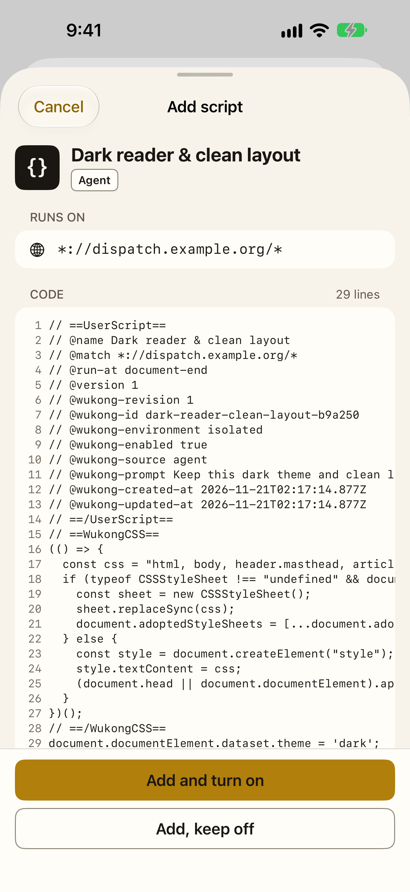
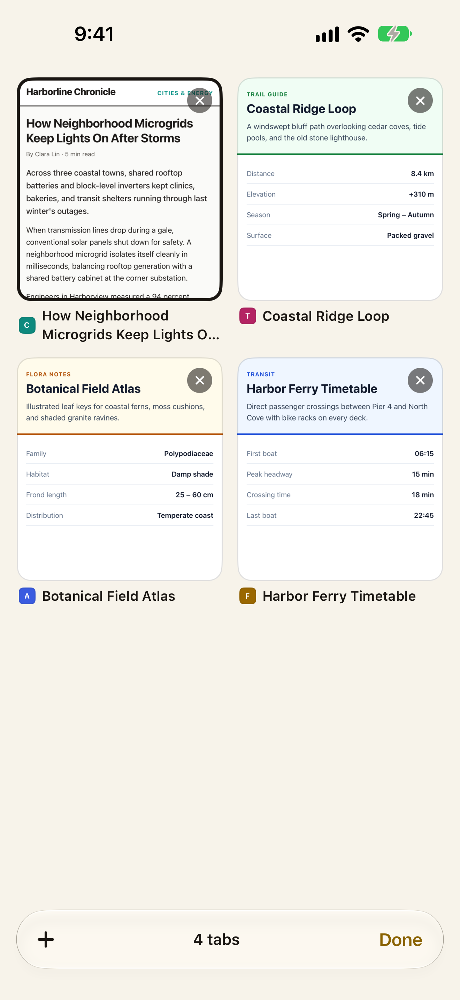
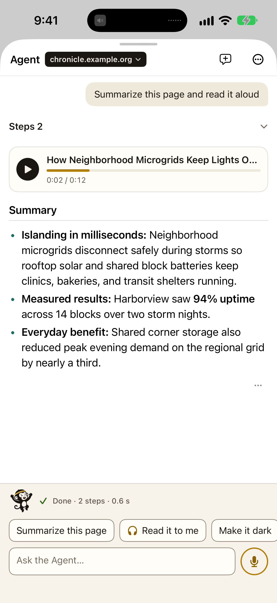
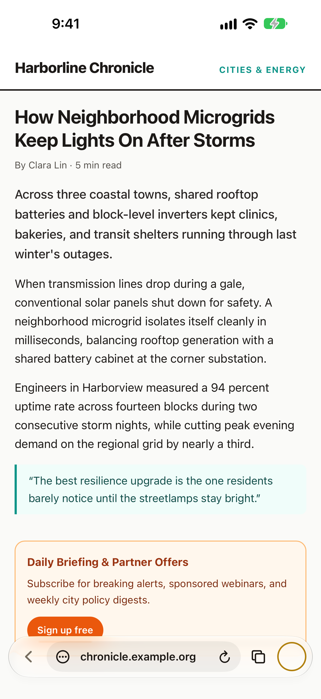
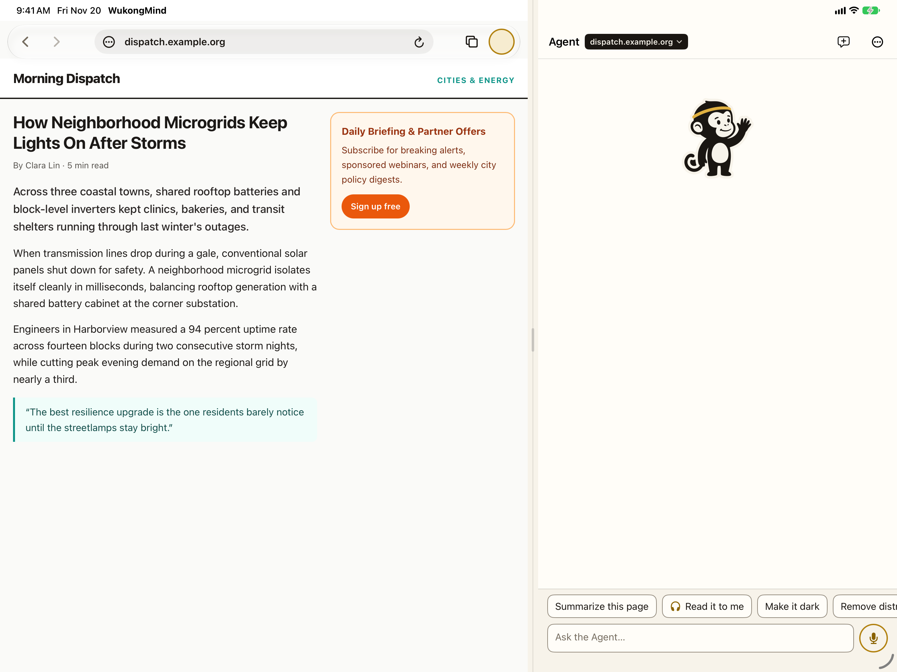

  
  <h1>WukongMind Browser</h1>
  
<strong>Make any web page work your way.</strong>

  
Too cluttered, too hard to read, too long? Say what you want in one sentence. The Agent changes the page in front of you, and keeps the change only if you approve it.

  

    
    
    
    
  

  

    <b>English</b> · <a href="README.zh-Hans.md">简体中文</a> · <a href="README.zh-Hant.md">繁體中文</a>
  

[][testflight]

---

## In the app

<table>
  <tr>
    <td align="center" width="33%">
       
      Change a page by asking
    </td>
    <td align="center" width="33%">
       
      See every step
    </td>
    <td align="center" width="33%">
       
      Approve before saving a script
    </td>
  </tr>
  <tr>
    <td align="center" width="33%">
       
      Tabs and overview
    </td>
    <td align="center" width="33%">
       
      Summarize and read aloud
    </td>
    <td align="center" width="33%">
       
      One gold ring in the browser bar
    </td>
  </tr>
</table>

   
  On iPad, the web page and the Agent sit side by side

---

## What you can do

- **Clean up any page** — hide banners, sidebars, and pop-ups, or switch a bright site to dark mode and larger text with a single sentence.
- **Keep what works for your next visit** — save a fix as a small per-site script so it runs automatically every time you open that site, only after you review and approve it.
- **Summarize and listen** — get the main points of a long article or discussion thread, ask follow-up questions, or listen with Read aloud and live voice.
- **Watch every step** — see each change as it happens, with **Stop** always on screen.
- **Use it as a full browser** — tabs, pinned sites, history, on-device translation (iOS 18+), optional ad and tracker blocking, and side-by-side browsing on iPad.

---

## Private by design · Bring your own key

There are no WukongMind accounts, servers, analytics, or tracking. Your API keys live in the iOS Keychain (with optional iCloud Keychain sync), and requests go straight from your device to the AI provider you choose — or to a local model on your own network.

- **Cloud (API key):** OpenRouter, OpenAI, Anthropic, Google Gemini, Google Vertex AI, Groq, xAI (Grok), DeepSeek, NVIDIA NIM.
- **Local network (no key):** Ollama, LM Studio.
- **On-device (Summaries only):** Apple Intelligence.

---

## Safety

> [!WARNING]
> **Web content can steer the agent, and the agent can use every login in the app. Do not log in to banking, payment, or main email accounts in WukongMind.**

- **Every step is shown and stoppable** — actions are listed as they happen, and **Stop** stays on screen for the entire run.
- **Asks before sensitive actions** — by default the Agent asks before sending network requests, posting notifications, reading cookies, or sending your login to another site.
- **Scripts are saved only with your approval** — before anything is kept, you see which sites it runs on, what it can use, and its full code.

For bridge isolation, key isolation, content delimiters, and the full threat model, see [docs/DEVELOPER.md](docs/DEVELOPER.md#risk-statement) and [SECURITY.md](SECURITY.md).

---

## Developers & License

- **Builds & releases:** Native SwiftUI app for iPhone and iPad (iOS / iPadOS 17+) with zero third-party dependencies, localized in English, Simplified Chinese (`zh-Hans`), and Traditional Chinese (`zh-Hant`). Try the beta on [TestFlight][testflight], or build from source with automated CI checks on every change.
- **Developers:** Build from source, run tests, and explore milestone status, tool internals, and architecture docs in **[docs/DEVELOPER.md](docs/DEVELOPER.md)**.
- **Policies & community:** [LICENSE](LICENSE) · [PRIVACY.md](PRIVACY.md) · [SECURITY.md](SECURITY.md) · [CONTRIBUTING.md](CONTRIBUTING.md) · [CODE_OF_CONDUCT.md](CODE_OF_CONDUCT.md) · [NOTICE](NOTICE).
- WukongMind is forked from **[Forumind](https://github.com/kccarlos/forumind)** (`Copyright 2026 kccarlos and Forumind contributors`) and is licensed under the **[Apache License 2.0](LICENSE)**. Optional ad and tracker blocking uses rules derived from [EasyList and EasyPrivacy](https://easylist.to/) (CC BY-SA 3.0; see [NOTICE](NOTICE)).
- WukongMind is an independent open-source project and is not affiliated with or endorsed by Civilized Discourse Construction Kit, Inc. ("Discourse"), WordPress, Hacker News, or Tampermonkey.

   
  Make any web page work your way — see the <a href="docs/wukongmind/design/design-system/README.md">design system</a> for tokens, ring states, and component specs.

[testflight]: https://testflight.apple.com/join/t5RNVr7M
