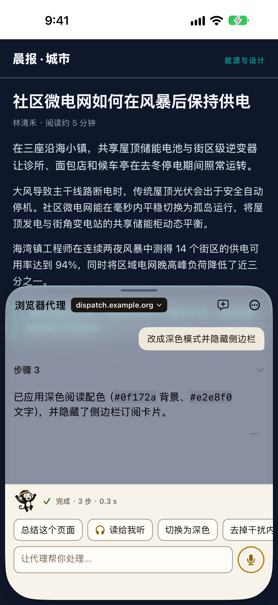
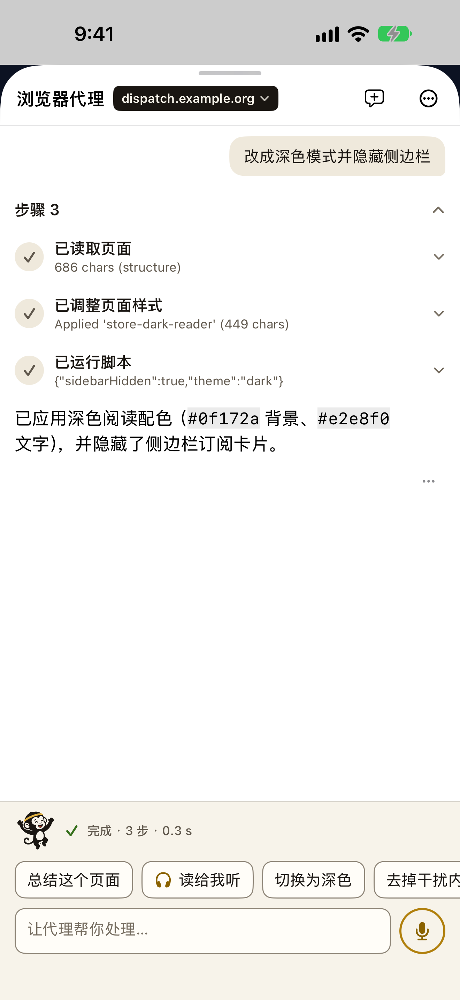
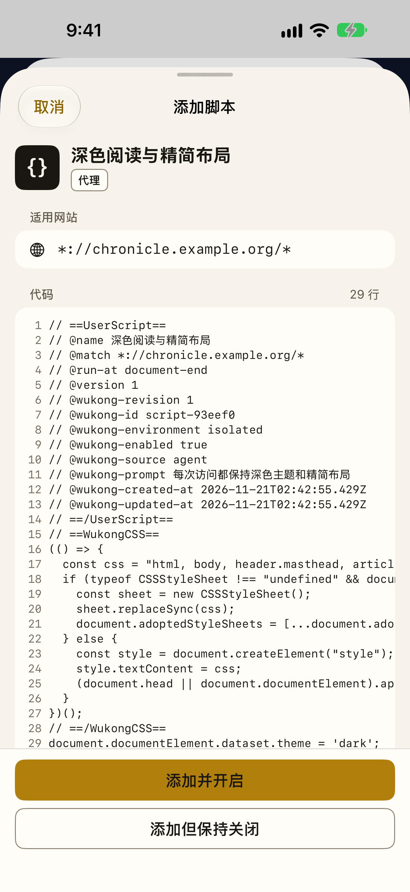
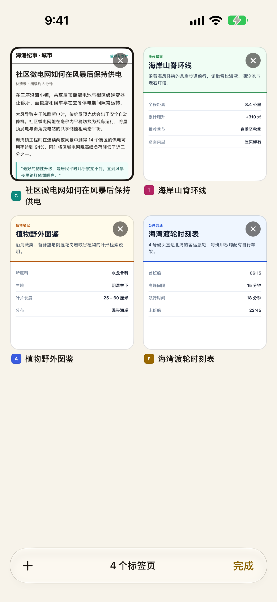
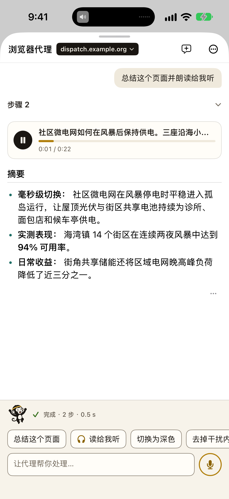
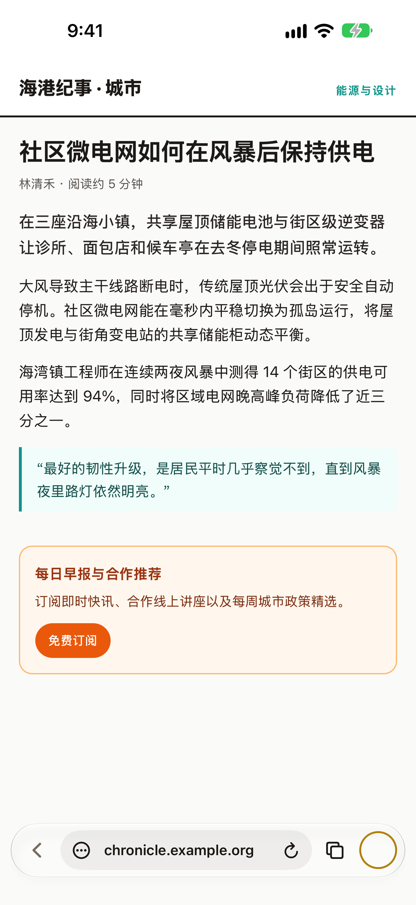
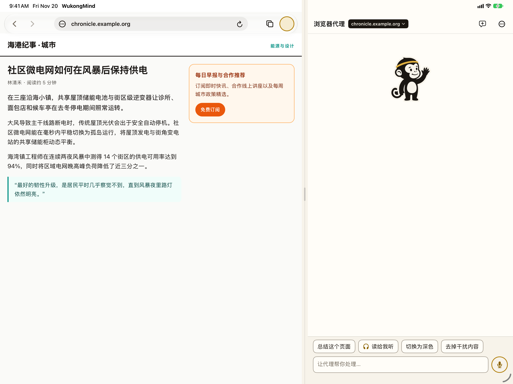

  
  <h1>WukongMind 浏览器</h1>
  
<strong>网页不顺手？说一句就改。</strong>

  
太乱、看着累、太长？用一句话说出你想要的。智能体当着你的面把网页改好；要不要留下这个修改，由你决定。

  

    
    
    
    
  

  

    <a href="README.md">English</a> · <b>简体中文</b> · <a href="README.zh-Hant.md">繁體中文</a>
  

[][testflight]

---

## App 里的样子

<table>
  <tr>
    <td align="center" width="33%">
       
      说一句，网页当场改好
    </td>
    <td align="center" width="33%">
       
      每一步都看得见
    </td>
    <td align="center" width="33%">
       
      保存脚本前先由你批准
    </td>
  </tr>
  <tr>
    <td align="center" width="33%">
       
      标签页与概览
    </td>
    <td align="center" width="33%">
       
      摘要与朗读
    </td>
    <td align="center" width="33%">
       
      浏览器栏里的金色圆环
    </td>
  </tr>
</table>

   
  在 iPad 上，网页和智能体并排显示

---

## 你能用它做什么

- **清理杂乱页面** — 一句话收起横幅、侧边栏和弹窗，或把刺眼的网页改成深色、调大字号，只留正文。
- **好用就留下来** — 把修改存成按网站生效的小脚本，下次打开自动套用；保存之前先由你看过代码并批准。
- **总结并读给你听** — 快速提炼长网页和讨论串的要点、继续追问，或开启朗读与实时语音对话。
- **全程透明，随时可停** — 智能体的每一步都实时列出，“停止”按钮始终在屏幕上。
- **完整的日常浏览器** — 标签页、置顶网站、历史记录、设备端翻译（iOS 18+）、可选广告与追踪器拦截，以及 iPad 并排模式。

---

## 隐私优先 · 自带密钥（BYOK）

没有 WukongMind 账号、后端服务器、统计分析或追踪。API 密钥保存在 iOS 钥匙串中（可选通过 iCloud 钥匙串同步），请求直接从你的设备发往所选 AI 提供方，或发往你局域网里的本地模型。

- **云端提供方（需 API 密钥）：** OpenRouter、OpenAI、Anthropic、Google Gemini、Google Vertex AI、Groq、xAI (Grok)、DeepSeek、NVIDIA NIM。
- **局域网本地服务（无需密钥）：** Ollama、LM Studio。
- **设备端（仅用于摘要）：** Apple 智能。

---

## 安全提醒

> [!WARNING]
> **网页内容可能会诱导智能体（提示词注入），且智能体可以使用你在本 App 中登录的所有会话。请勿在 WukongMind 中登录银行、支付或主力邮箱等高风险账户。**

- **每一步都看得见，随时能停** — 对页面的所有操作都会实时展示，“停止”按钮全程停留在屏幕上。
- **敏感操作前先征求确认** — 默认情况下，发起网络请求、发送通知、读取 Cookie 或向其他网站发送登录态之前，都会停下来问你。
- **脚本必须经你批准才会保存** — 保存或更新前，你会看到它适用的网站、可用权限和完整代码。

桥接隔离、密钥隔离、不受信任内容标记及完整威胁模型详见 [docs/DEVELOPER.md](docs/DEVELOPER.md#risk-statement)（英文）与 [SECURITY.md](SECURITY.md)。

---

## 开发者与许可证

- **构建与发布：** 原生 SwiftUI 应用，支持 iPhone 与 iPad（iOS / iPadOS 17+），零第三方依赖，提供 English、简体中文（`zh-Hans`）与繁體中文（`zh-Hant`）三种语言。欢迎加入 [TestFlight][testflight] 测试，或从源码构建，每次改动均通过自动化 CI 检查。
- **开发者入口：** 从源码构建、运行测试、里程碑进展、工具原理与完整文档索引请参阅 **[docs/DEVELOPER.md](docs/DEVELOPER.md)**（英文）。
- **政策与社区：** [LICENSE](LICENSE) · [PRIVACY.md](PRIVACY.md) · [SECURITY.md](SECURITY.md) · [CONTRIBUTING.md](CONTRIBUTING.md) · [CODE_OF_CONDUCT.md](CODE_OF_CONDUCT.md) · [NOTICE](NOTICE)。
- WukongMind 派生自 **[Forumind](https://github.com/kccarlos/forumind)**（`Copyright 2026 kccarlos and Forumind contributors`），采用 **[Apache License 2.0](LICENSE)** 开源许可。可选广告与跟踪器拦截规则源自 [EasyList 和 EasyPrivacy](https://easylist.to/)（CC BY-SA 3.0，详见 [NOTICE](NOTICE)）。
- 本项目为独立开源项目，与 Civilized Discourse Construction Kit, Inc.（"Discourse"）、WordPress、Hacker News 及 Tampermonkey 均无关联。

   
  网页顺手，逛得轻松 — 完整的颜色标记、圆环状态与组件规范见<a href="docs/wukongmind/design/design-system/README.md">设计系统文档（英文）</a>。

[testflight]: https://testflight.apple.com/join/t5RNVr7M
