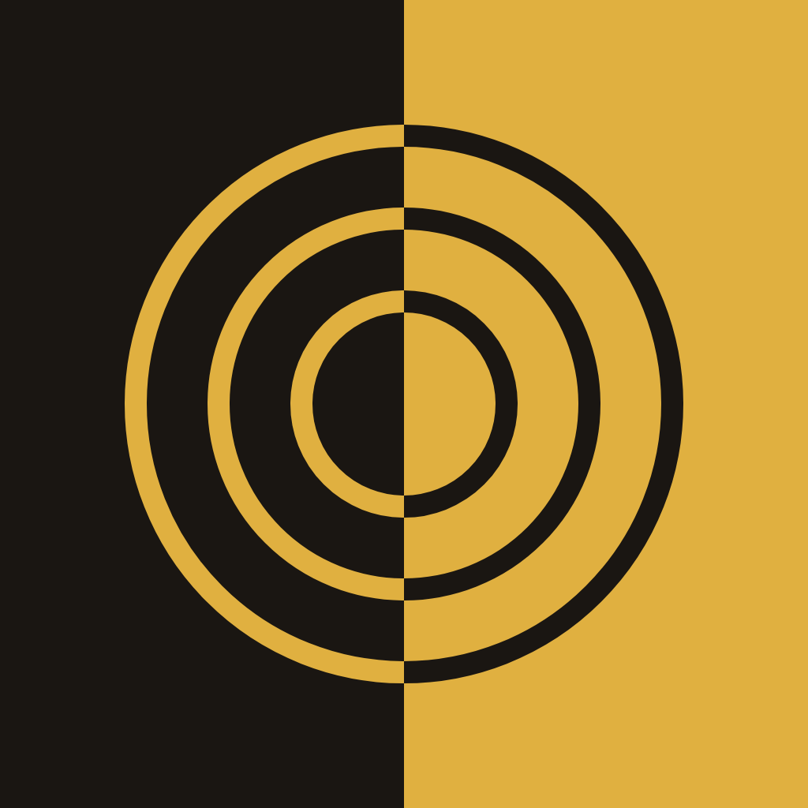
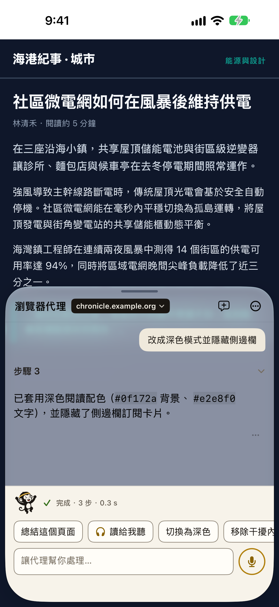
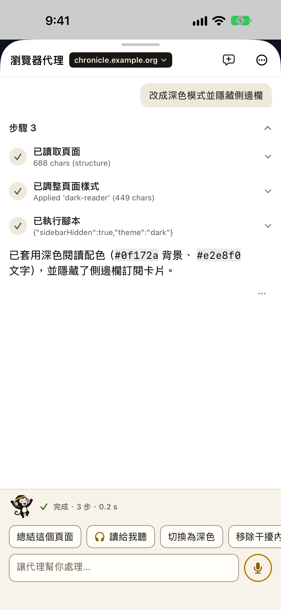
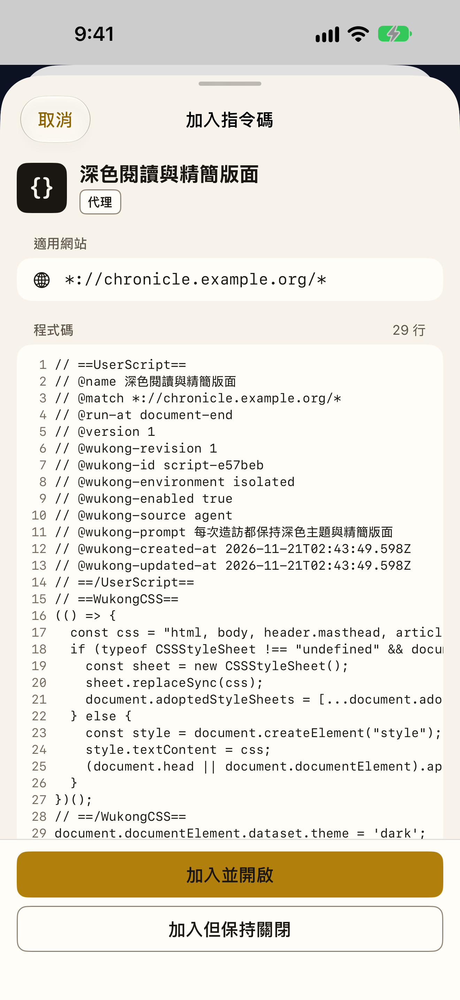
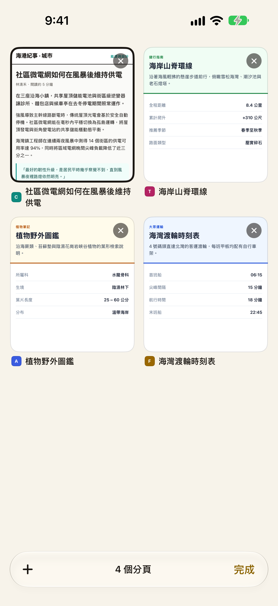
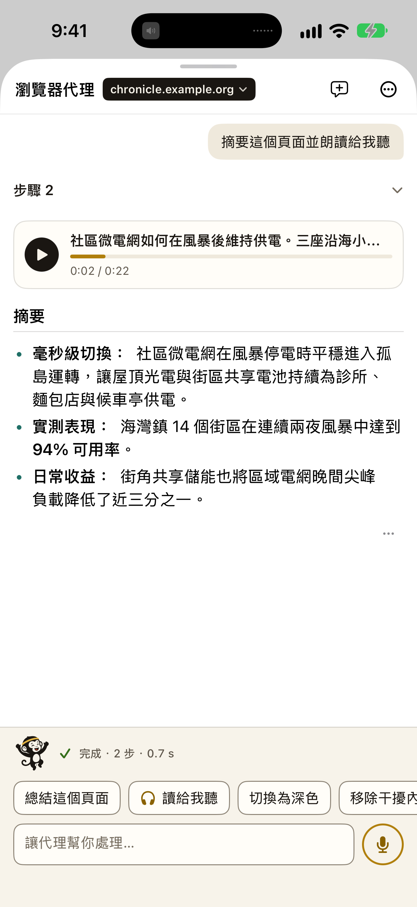
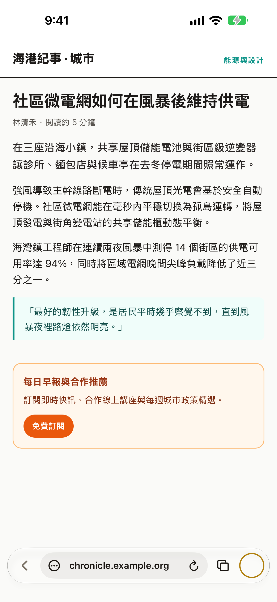
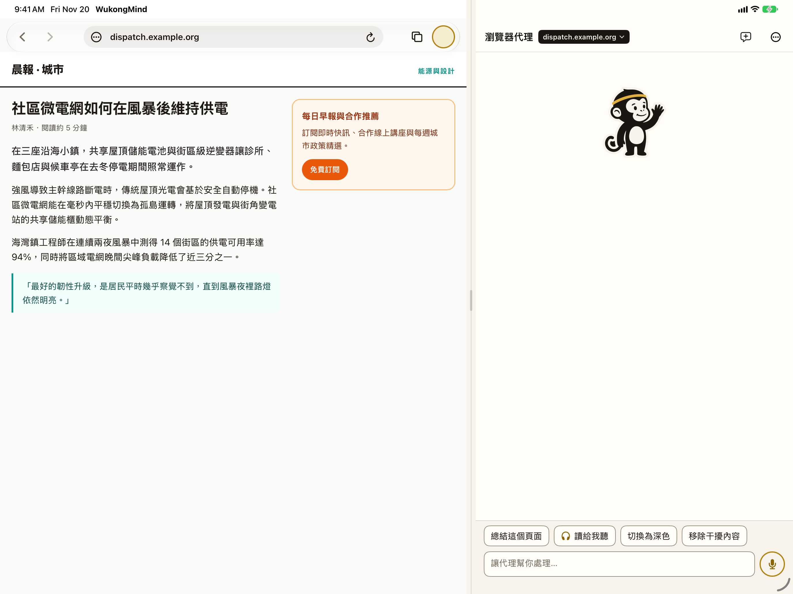
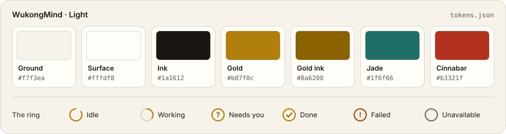
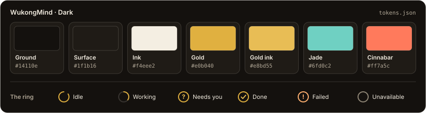

  
  <h1>WukongMind 瀏覽器</h1>
  
<strong>網頁用不順手？說一句就改。</strong>

  
太亂、看得吃力、太長？用一句話說出你想要的。代理當著你的面把網頁改好；要不要留下這個修改，由你決定。

  

    
    
    
    
  

  

    <a href="README.md">English</a> · <a href="README.zh-Hans.md">简体中文</a> · <b>繁體中文</b>
  

[][testflight]

---

## App 裡的樣子

<table>
  <tr>
    <td align="center" width="33%">
       
      說一句，頁面當場改好
    </td>
    <td align="center" width="33%">
       
      每一步都看得見
    </td>
    <td align="center" width="33%">
       
      儲存腳本前先由你核准
    </td>
  </tr>
  <tr>
    <td align="center" width="33%">
       
      分頁與概覽
    </td>
    <td align="center" width="33%">
       
      摘要與朗讀
    </td>
    <td align="center" width="33%">
       
      瀏覽器列裡的金色圓環
    </td>
  </tr>
</table>

   
  在 iPad 上，網頁和代理並排顯示

---

## 你能用它做什麼

- **整理雜亂頁面** — 一句話收起橫幅、側邊欄與彈出視窗，或把刺眼的網站改成深色、放大字體，只留下內文。
- **好用就留下來** — 把修改存成依網站自動套用的小腳本，下次造訪直接生效；儲存之前先由你看過程式碼並核准。
- **摘要並念給你聽** — 快速掌握長文章與討論串重點、接著追問，或開啟朗讀與即時語音對話。
- **全程透明，隨時可停** — 代理的每一步都會即時列出，「停止」按鈕始終停留在螢幕上。
- **完整的日常瀏覽器** — 分頁、釘選網站、瀏覽記錄、裝置端翻譯（iOS 18+）、選用廣告與追蹤器封鎖，以及 iPad 並排檢視。

---

## 用心打磨的設計

WukongMind 捨棄漸層與繁雜裝飾，以四種水墨色彩傳達四種語意：**墨**落在宣紙與漆黑底色上，**金**代表代理與圓環，**青**標示來自網頁的內容，**朱**只用於停止與錯誤。字體僅使用系統字型（**SF Pro**、**蘋方**與程式碼用的 **SF Mono**），配合 iOS 動態字體，並以細緻分隔線取代厚重陰影。

  

  

   
  完整的色彩標記、圓環狀態與元件規範見<a href="docs/wukongmind/design/design-system/README.md">設計系統文件（英文）</a>。

---

## 隱私優先 · 自備金鑰（BYOK）

沒有 WukongMind 帳號、後端伺服器、分析或追蹤。API 金鑰保存在 iOS 鑰匙圈中（可選用 iCloud 鑰匙圈同步），請求直接從你的裝置送往所選 AI 供應商，或送往區域網路上的本機模型。

- **雲端供應商（需 API 金鑰）：** OpenRouter、OpenAI、Anthropic、Google Gemini、Google Vertex AI、Groq、xAI (Grok)、DeepSeek、NVIDIA NIM。
- **區域網路本機伺服器（不需金鑰）：** Ollama、LM Studio。
- **裝置端（僅用於摘要）：** Apple Intelligence。

---

## 安全提醒

> [!WARNING]
> **網頁內容可能會引導或操控代理（提示詞注入），且代理可以使用你在本 App 中登入的所有工作階段。請勿在 WukongMind 中登入銀行、付款或主要電子郵件等高風險帳號。**

- **每一步都看得到，隨時能停** — 對頁面的所有操作都會即時列出，「停止」按鈕全程停留在螢幕上。
- **敏感操作前先徵詢確認** — 預設情況下，傳送網路要求、發送通知、讀取 Cookie 或將登入狀態送往其他網站前，都會停下來問你。
- **腳本必須經你核准才會儲存** — 儲存或更新前，你會看到它適用的網站、可用權限與完整程式碼。

橋接隔離、金鑰隔離、不受信任內容標記與完整威脅模型詳見 [docs/DEVELOPER.md](docs/DEVELOPER.md#risk-statement)（英文）與 [SECURITY.md](SECURITY.md)。

---

## 專案現況

- **TestFlight 版本 1.6.2** — 單一程式碼庫，App Store、TestFlight 與原始碼自建版本擁有完全相同的行為與預設安全設定。
- **三種語言** — English、简体中文（`zh-Hans`）與繁體中文（`zh-Hant`）。
- **iPhone 與 iPad** — 原生 SwiftUI 應用程式（iOS / iPadOS 17+），無任何第三方相依套件。
- **開放原始碼** — 採用 [Apache License 2.0](LICENSE) 授權，每次變更皆經過自動化 CI 檢查。

---

## 開發者與授權條款

- **開發者入口：** 從原始碼建置、執行測試、里程碑進度、工具原理與完整文件索引請參閱 **[docs/DEVELOPER.md](docs/DEVELOPER.md)**（英文）。
- **政策與社群：** [LICENSE](LICENSE) · [PRIVACY.md](PRIVACY.md) · [SECURITY.md](SECURITY.md) · [CONTRIBUTING.md](CONTRIBUTING.md) · [CODE_OF_CONDUCT.md](CODE_OF_CONDUCT.md) · [NOTICE](NOTICE)。
- WukongMind 衍生自 **[Forumind](https://github.com/kccarlos/forumind)**（`Copyright 2026 kccarlos and Forumind contributors`），採用 **[Apache License 2.0](LICENSE)** 開放原始碼授權。選用的廣告與追蹤器阻擋規則源自 [EasyList 和 EasyPrivacy](https://easylist.to/)（CC BY-SA 3.0，詳見 [NOTICE](NOTICE)）。
- 本專案為獨立開放原始碼專案，與 Civilized Discourse Construction Kit, Inc.（"Discourse"）、WordPress、Hacker News 及 Tampermonkey 皆無關聯。

<!-- Coordinator: replace the URL below with the public TestFlight link once it is live. -->
[testflight]: https://kccarlos.github.io/WuKongMind/
