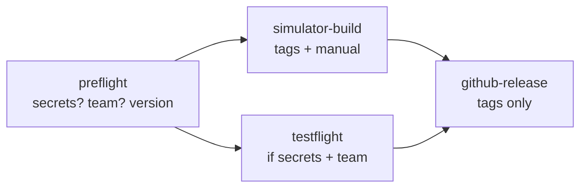

# CI / CD

Three GitHub Actions workflows live in `.github/workflows/`. The helper scripts
in `scripts/ci/` also run locally.

| Workflow | When | What |
| --- | --- | --- |
| `ci.yml` | Every pull request and push to `main` | Lint, project drift, unit tests, unsigned Release build |
| `release.yml` | Tags `v*`, or manual (`workflow_dispatch`) | TestFlight upload, unsigned simulator build, and (for tags) GitHub Release |
| `update-filter-lists.yml` | Mondays, or manual | Refreshes the ad-blocking rules and opens a PR ([AD_BLOCKING.md](AD_BLOCKING.md)) |

## `ci.yml`

| Job | Runner | What it does |
| --- | --- | --- |
| `lint` | `ubuntu-latest` | Validates tracked `.plist`, `.entitlements`, and `.xcprivacy` files (`lint-plists.sh`); ShellChecks `scripts/ci` and `scripts/adblock`; checks `fastlane/Fastfile` syntax; runs the ad-blocking converter tests; runs `actionlint`. |
| `project-drift` | `ubuntu-latest` | Runs `scripts/generate_project.rb` in a temporary copy and fails if the committed `WukongMind.xcodeproj` differs (`check-project-drift.sh`); checks the site-adapter layering boundary (`check-site-layering.sh`). |
| `build-test` | `xcode-27` | Picks an iPhone simulator and runs the `WukongMindTests` unit tests, unsigned. Uploads the `.xcresult` bundle on failure. |
| `release-build` | `xcode-27` | Builds the **Release** configuration for a generic iOS device, unsigned, to catch errors that only show up in Release (for example, code that is only compiled in DEBUG). |

A newer push to the same branch or pull request cancels the run in progress.
UI tests don't run in CI; run them locally
([DEVELOPMENT.md](DEVELOPMENT.md#ui-tests)).

**Test retries.** `build-test` runs `xcodebuild test` with
`-retry-tests-on-failure -test-iterations 3`: a test passes if any of up to 3
attempts passes, so timing flakes in the inherited suite don't block pull
requests. Nothing is hidden: an always-run step (`scripts/ci/flaky-summary.sh`)
reads `TestResults.xcresult` and lists every test that failed an attempt but
passed on retry under "Flaky tests (passed on retry)" in the job summary. It
never fails the job. Fix what shows up there; known cases are in
[flaky-tests.md](wukongmind/flaky-tests.md).

**Project drift.** The generator creates random object UUIDs each run, so a
plain `git diff` would always report changes. The check compares the object
graph with UUIDs removed (`xcodeproj-tree.rb`) and the scheme without
`BlueprintIdentifier` lines. It always generates with the defaults (no team,
default bundle IDs, build 1, so no CloudKit and the committed base
entitlements), ignoring `DEVELOPMENT_TEAM`, `BUNDLE_ID_PREFIX`,
`BUILD_NUMBER`, `DC_ENABLE_PCC`, and `DC_ENABLE_CLOUDKIT`. To fix a failure,
run `env -u DEVELOPMENT_TEAM ruby scripts/generate_project.rb` (and without
the other variables, and without a `Config/DevelopmentTeam.txt`, which the
check never sees) and commit.

**iCloud sync in CI.** Pull request builds are unsigned and generated without
a team, so CloudKit is off in them: no iCloud entitlement and no
`CLOUDKIT_ENABLED`, and sync reports itself unavailable. That is intended: an
app that calls CloudKit without the entitlement crashes, and unit tests never
touch iCloud. Only the TestFlight job, which regenerates with
`DEVELOPMENT_TEAM`, builds with CloudKit ([SYNC.md](SYNC.md)).

**Simulator.** `pick-simulator.sh` reads `xcrun simctl list -j` and picks an
iPhone on the newest iOS runtime, as `platform=iOS Simulator,id=<UDID>`, so the
job survives device renames. `SIM_PREFER` and `SIM_EXCLUDE` take
comma-separated device names.

**Optional secrets:** `NVIDIA_API_KEY` runs the live NVIDIA NIM test and
`VERTEX_API_KEY` the live Vertex AI test; without them, those tests are skipped.

## `release.yml`



1. **preflight** (Linux) checks which secrets and variables exist and validates
   the version (`scripts/ci/check-release-version.sh`). Tag `v1.2.3` must match
   `marketing_version` in `scripts/generate_project.rb` and the committed
   `WukongMind.xcodeproj` (an optional pre-release suffix like `-beta.1` is
   dropped for `CFBundleShortVersionString`); manual runs use the `version`
   input, or fall back to the project's version when empty.
   The **build number** is `BUILD_NUMBER_BASE` (repo variable, default 100)
   plus `github.run_number`, so it always goes up, as App Store Connect
   requires, and starts above builds uploaded from Xcode.
2. **simulator-build** (tags and manual runs) builds an unsigned Release `.app` for the
   simulator and uploads `WukongMind-simulator.app.zip`.
3. **testflight** (when `OP_SERVICE_ACCOUNT_TOKEN` and `DEVELOPMENT_TEAM` are
   present, and the `testflight` input is on):
   - regenerates the project with `BUILD_NUMBER` and the workflow's signing and
     capability settings (`DEVELOPMENT_TEAM`, `BUNDLE_ID_PREFIX`,
     `DC_ENABLE_PCC`, `DC_ENABLE_CLOUDKIT`, `DC_ENABLE_SHARE_EXTENSION`,
     `DC_ENABLE_APP_GROUP`),
   - installs the API key and distribution certificate (`import-signing.sh`),
     and fetches `PROFILE_APP` via `fetch-profiles.rb` (falling back to
     automatic signing with the API key if no profile with that name exists yet),
   - archives and exports an App Store IPA (`write-export-options.sh`),
   - uploads it with `bundle exec fastlane beta`. With the `TESTFLIGHT_GROUPS`
     variable set (for example `Myself`), it waits for processing and
     distributes the build to those groups with the commit message as "What to
     Test". A distribution error leaves the upload in place and shows as a
     warning, so a build waiting for Beta App Review doesn't fail the run,
   - keeps `WukongMind.ipa` and `WukongMind-dSYMs.zip` as workflow artifacts,
     and deletes the keychain and key files at the end (`cleanup-signing.sh`).
4. **github-release** (tags only) creates a GitHub Release with generated
   notes and attaches the simulator build and, when TestFlight ran, the
   dSYMs. Tags with `-` (for example `v1.3.0-beta.1`) become pre-releases.

With no secrets, the workflow still passes: you get the simulator build and a
GitHub Release, and the signed job is skipped with a notice.

### Cutting a release

Bump `marketing_version` in `scripts/generate_project.rb`, regenerate
`WukongMind.xcodeproj`, and merge to `main`. Then tag `main` to build, upload to
TestFlight, and publish a GitHub Release (or trigger `workflow_dispatch` for a
manual build):

```sh
git tag v1.1.2 && git push origin v1.1.2

gh workflow run release.yml --ref main -f testflight=true   # manual TestFlight run
```

### Why xcodebuild + fastlane

- **Building** uses plain `xcodebuild` (archive, export). It's the same
  command you run locally, has no extra dependency, and its errors are easy to
  read.
- **Talking to App Store Connect** uses fastlane (`fastlane/Fastfile`):
  `upload_to_testflight` (`fastlane beta`) uploads the signed IPA, optionally
  waits for processing, and distributes the build to `TESTFLIGHT_GROUPS`.

fastlane needs Ruby 3.1 or later. CI installs Ruby 3.3 and the gems from the
`Gemfile` (`bundler-cache`). Locally: install a current Ruby (Homebrew or
rbenv), then `bundle install`. Commit the `Gemfile.lock` that the first
`bundle install` creates.

## Secrets and variables

Add them under **Settings › Secrets and variables › Actions**, or with `gh`
from the repo root:

```sh
R=kccarlos/WuKongMind

# Secret: the only signing secret is a 1Password service account token that
# can read the vault `github`; the jobs load the rest with
# 1password/load-secrets-action. Repository level (see below).
# -n: no trailing newline (with one, every load fails with "(400) structure
# of request was invalid").
op read -n "op://Private/OP service account github-actions/credential" | gh secret set OP_SERVICE_ACCOUNT_TOKEN -R $R

# The 1Password items in vault `github` (every value one line, files base64):
#   app-store-connect-api-key       key_id, issuer_id, p8_base64
#     App Store Connect › Users and Access › Integrations › App Store Connect API
#     › Team Keys, role "App Manager" (or "Admin"); base64 of AuthKey_<id>.p8.
#   apple-distribution              p12_base64, password
#     Apple Distribution certificate + private key, exported from Keychain
#     Access as .p12 (recommended; see below).

# Secrets (optional): live NVIDIA NIM and Vertex AI tests in CI.
gh secret set NVIDIA_API_KEY -R $R
gh secret set VERTEX_API_KEY -R $R

# Variables (not secret).
gh variable set DEVELOPMENT_TEAM -R $R --body 'YOURTEAMID'                          # required for TestFlight
gh variable set BUNDLE_ID_PREFIX -R $R --body 'io.github.kccarlos.wukongmind' # optional (this is the default)
gh variable set DC_ENABLE_PCC    -R $R --body 'YES'   # optional: only once Apple has assigned the PCC entitlement
gh variable set DC_ENABLE_CLOUDKIT -R $R --body 'NO'  # optional: only to ship without iCloud sync (default: on with a team)
```

| Name | Kind | Needed for |
| --- | --- | --- |
| `OP_SERVICE_ACCOUNT_TOKEN` | secret | TestFlight (reads the 1Password items above) |
| `app-store-connect-api-key` | 1Password item | TestFlight |
| `apple-distribution` | 1Password item | TestFlight |
| `NVIDIA_API_KEY` | secret | Optional live test |
| `VERTEX_API_KEY` | secret | Optional live test |
| `DEVELOPMENT_TEAM` | variable | TestFlight |
| `BUNDLE_ID_PREFIX` | variable | Optional, forks |
| `DC_ENABLE_PCC` | variable | Optional, `YES` to build with Private Cloud Compute ([APPLE_INTELLIGENCE.md](APPLE_INTELLIGENCE.md)) |
| `DC_ENABLE_CLOUDKIT` | variable | Optional, `YES` to build with iCloud sync once the container is registered |
| `BUILD_NUMBER_BASE` | variable | Optional, added to the run number (default 100) |
| `TESTFLIGHT_GROUPS` | variable | Optional, external TestFlight groups (comma-separated) that get every build |
| `CI_MACOS_RUNNER`, `CI_XCODE_APP` | variable | Optional runner override (below) |

Signing notes:

- Signing is **manual** when an active profile named `PROFILE_APP` (default
  `WukongMind App Store`) exists on App Store Connect: `scripts/ci/fetch-profiles.rb`
  downloads it by name through the App Store Connect API (read-only), and the
  archive and export sign with the Apple Distribution identity from
  `apple-distribution`. If no profile with that name exists yet, `release.yml`
  falls back to automatic signing with the App Store Connect API key.
- Create or refresh the profile once, outside CI, when it expires (with the
  distribution certificate) or when the app gains a capability:
  `asc --write profiles create --bundle <bundle id resource> --certificate <distribution certificate id> --name "WukongMind App Store" --profile-type IOS_APP_STORE`,
  then delete or let the old one go invalid so only one active profile has that name.
- `gh secret set NAME` only prompts in an interactive terminal; elsewhere it
  stores whatever arrives on stdin (an empty password makes the p12 import
  fail with "passphrase … not correct").
- Create the app record in App Store Connect before the first upload.
- iCloud sync adds the **iCloud (CloudKit)** and **Push Notifications**
  capabilities and the container `iCloud.<BUNDLE_ID_PREFIX>` to the app's App
  ID. Enable them on the App ID first; profiles made before that are invalid
  for the app afterwards, so regenerate the App Store profile.
- Deploy the CloudKit schema to production before enabling CloudKit in
  TestFlight builds ([SYNC.md](SYNC.md#cloudkit-schema)).
- Each job loads 1Password in up to **three attempts, 30 s apart** (steps
  `op1`..`op3`; the first two may fail without failing the job, and later
  steps read `steps.op1.outputs.X || steps.op2.outputs.X || steps.op3.outputs.X`).
  The 1Password CLI fails intermittently on macOS 27, GitHub's `xcode-27`
  runners included, with `(400) … structure of request was invalid` or
  `error initializing client: (500)`, even with a good token.
- Keep `OP_SERVICE_ACCOUNT_TOKEN` at **repository** level. Preflight has no environment,
  so it can't see environment-only secrets; the upload would always be
  skipped.
- The `testflight` job uses a GitHub Environment named `testflight` (GitHub
  creates it on the first run). Add required reviewers to it (Settings ›
  Environments) if you want to approve each upload.

## Runners and cost

Jobs run on the GitHub-hosted **`xcode-27`** image (macOS 27, Xcode 27.2 at
`/Applications/Xcode_27.2.app`). If that image is unavailable, point the jobs
elsewhere without editing YAML:

```sh
gh variable set CI_MACOS_RUNNER -R kccarlos/WuKongMind --body macos-26
gh variable set CI_XCODE_APP    -R kccarlos/WuKongMind --body /Applications/Xcode_26.6.app
```

If the configured Xcode is missing, `select-xcode.sh` falls back to the image
default with a warning.

**Cost.** GitHub-hosted standard runners, macOS included, are free for public
repositories. While the repository is private, Actions minutes are billed
(macOS minutes count about 10x Linux minutes against the included quota), and
runs fail to start if billing is blocked. To keep macOS time low anyway, lint
and drift checks run on Linux, UI tests stay local, and superseded runs are
cancelled.

## Running the checks locally

```sh
scripts/ci/lint-plists.sh
scripts/ci/check-project-drift.sh              # needs: gem install xcodeproj
scripts/ci/check-site-layering.sh
shellcheck scripts/ci/*.sh scripts/adblock/*.sh
actionlint
DEST=$(scripts/ci/pick-simulator.sh)
xcodebuild test -project WukongMind.xcodeproj -scheme WukongMind \
  -destination "$DEST" -only-testing:WukongMindTests CODE_SIGNING_ALLOWED=NO
```

To upload from your Mac instead of CI (with the same environment variables
as the secrets above):

```sh
bundle install
bundle exec fastlane beta ipa:path/to/WukongMind.ipa
```
