# Unified interface design (whole app)

The One panel milestone builds against this page and the design canvas:
**https://claude.ai/artifact/Daefr4AsZcSm2EWbTLU9uK**. The canvas has the information architecture, the answers to the six directions, artboards for iPhone and iPad in light and dark (the assistant panel on a forum thread and on an ordinary page, tool results in the conversation, the suggestion row, keyboard up, "This page", Home, Settings, the three onboarding steps), motion storyboards, the migration list and the glossary.

It follows roadmap v2, "Just ask" ([next-phase.md](next-phase.md), which v2 replaces in full): the revision table in its section 2, the product rules in section 3, the end state in section 4, where each existing piece goes in section 6, the milestones in section 7 and developer mode in section 8. The roadmap wins where this page, [requirements.md](requirements.md) or [README.md](README.md) disagree. This page builds on [design-m1.md](design-m1.md) and [design-m2.md](design-m2.md) and their canvases for structure.

**Looks come from the WukongMind design system: https://claude.ai/artifact/5fGhnS4fmcmWYZbPoKTTZ2.** It replaces Forumind's `DCTheme` look (the blue-to-purple gradient, capsule pills, the purple Agent and the multicoloured tiles); its README has the table that maps each `DCTheme` token to its new token. Every board uses its tokens and components:
- **Tokens.** Surfaces are `ground` (warm paper, or lacquer black in dark) and `surface`. Text is `ink`, `ink-muted` and `ink-faint`. Edges are `hairline`, and controls take `border-strong`. Radii are `radius-sm` 6, `radius-md` 10, `radius-lg` 14 and `radius-sheet` 28. Type uses the iOS text styles.
- **Four colours, four meanings.**
  - **Gold** (`gold`, `gold-ink`, `gold-wash`) is the Agent and the one primary action. Text on a gold fill is `on-gold`.
  - **Jade** (`jade`, `jade-wash`) is content that came from a website: result card headers and citation numbers.
  - **Cinnabar** is stop, delete and error, and nothing else.
  - **Ink** is structure: text, seals and the settings icon tiles.
  There are no gradients.
- **Components.**
  - The input box is the **Composer**. Its field is a rounded rectangle, and its one round ring button is an open gold ring with a mic when the box is empty, gold filled with an arrow to send, and cinnabar with a square to stop.
  - **SuggestionRow** chips are outlined, `radius-md`, with an optional `gold-ink` icon.
  - **ToolRow** has a 28 pt disc: a check when done, a turning gold ring while running, a cinnabar triangle on error. By default it shows a plain label ("Read page", "Ran script", "Saved script", "Searched forum") and no duration; the tool's code name in monospace and its duration show only in developer mode. When a run ends its rows fold into "Steps N".
  - **ResultCard** shows the summary card, the answer with numbered sources and the listen row, each with a jade header.
  - **ScriptCard** has a gold-wash braces tile.
  - **Message** draws the user's bubble on `surface-raised`, the Agent's plain text and the gold "Saved. Faster next time." note.
  - **Seal** labels are squared, never capsules: the ink This page seal beside the title, and gold seals for Agent counts.
  - **Switch** has a gold track with a dark knob.
  - Settings rows are **ListRow**s with ink tiles. The Agent's tile is gold with a ring.
  - The **BrowserBar** carries the Agent ring.
- **The Agent's mark is the thin gold ring.** It is the Agent button in the browser bar (44 pt, a `gold` stroke of `ring-width` (2 px), empty centre, with an ink seal for the script count) and the composer's button, and it turns while a tool runs. There is no sparkle and no purple anywhere.
- **Logo.** Onboarding step 1 shows the mark (the split ink and gold square with three thin rings), with "WukongMind" beside it in semibold `ink`.
- **Mascot** (at most one per screen; the design system's Mascot README):
  - `wave` (128 pt) fills the empty panel.
  - While the Agent works, one 40 pt pose sits inside the status line, on the same line as the status text, and hides with it. It never floats over the conversation: `think` while waiting on the model, `run` while tools run, `search` while it reads the page, searches a site or learns one.
  - `cheer` shows when a run ends, for about 3 seconds, and in onboarding's "You're set" card.
  - It never appears in the bar, in buttons, in lists, beside every message or with errors.
  - With Reduce Motion it doesn't change pose mid-run; it shows `think` until the result.
- **Motion.** The turning ring is the only continuous animation. By the owner's decision, two short transitions are allowed besides the system ones: a suggestion flying into the input box, and a result rising into view (section 6).

**The end state in one line:** one input box and a mic on every page, no modes, no target switch, one Agent loop. Forum summary, search, podcast and voice become the Agent's tools. The boards draw that look, which the One panel milestone already ships. What changes between milestones is only what runs behind a tap (section 1, "Phases").

**Gold and the ring mean only the Agent.** That covers the bar's ring and its count, the composer's ring, Agent conversations in Recent and History, a running tool row and the "saved" note.
- **Site type is internal state.** The This page seal shows the host and the script count ("talk.example.org · 2 scripts"), never "Forum". The forum's grey speech-bubble badge stays only on Home's site tiles; onboarding's site list no longer has it.
- **M1 and M2 screens** (script card, script manager, code editor) finish as designed. Moving them onto the design system belongs to this design's implementation.

**What the boards draw that is not to be built as copy:**
- **Placeholders.** Dashed, dimmed rows marked with a later milestone (M3, One loop, M4, Learn on ask) only show where that milestone's screen goes. The implementation ships no disabled rows: each milestone adds its own row in the place shown.
- **Captions.** Notes that explain a board sit in the canvas's sticky notes, not inside the mock UI.

**Two rules from the owner, for every screen:**
- **Menus are native menus only.** A SwiftUI `Menu` (`UIMenu`) holds only these: buttons (a title, an SF Symbol and an optional subtitle), checkmark or toggle state, submenus, inline sections and dividers, the destructive role, and the small or medium palette sizes. It never holds custom views, switches, sliders, chips, badges or text fields. Here is where each of this design's menus stands:
  - The panel's ⋯ menu holds model choice: a "Model" submenu of the Agent's models with a checkmark on the current one, plus "Models…".
  - The panel's ⋯ and the summary card's ⋯ hold buttons only. Export options… opens its sheet.
  - The iPhone browser menu and the iPad More menu hold buttons only.
  - Following, the script switches and "Block ads here" are real `Toggle`s, so they live in the This page **popover**, never in a menu.
  - The tile actions on Home (Pin, Unpin, Remove) are a `contextMenu` of buttons.
  - Suggestions are plain buttons in a row, not a menu.
- **The UI explains itself.** Labels stay short. Layout, icons and state carry the meaning. No line of copy explains how the screen works:
  - A suggestion that doesn't apply is simply absent. Nothing is ever greyed out (roadmap section 3).
  - What the Agent can't do, it says in the conversation in a sentence or two, not through UI state.
  - Settings rows carry no explanatory footers beyond what Forumind's existing pages already have.
  - Onboarding keeps one short subtitle per step.
  Designer notes live in this file and in the canvas's sticky notes, outside the frames.

**Status: revised for roadmap v2, the design system and the owner's decisions, for the owner to confirm.** Nothing here is built until the owner confirms the information architecture, the artboards and the migration list. M2's UI tasks finish to their current design. Moving them is part of this design's implementation, and no M2 screen is redrawn here. Screens the cleanup deletes (consent, terms, report, moderation) need no migration and are only listed.

## The six directions, answered

1. **One input box plus suggestions.** One panel (`AssistantPanel`) with one input box and one mic on every page. Its title is always **Agent**; the Agent's model is chosen in the panel's ⋯ menu. There are no modes and no target switch.
   - **Suggestions.** A row of suggestions sits right above the input box. Each is a full question you could type or say yourself, and a tap sends it. A suggestion that ends in "…" only fills the box with the start of a sentence for you to finish. Typing or saying the same thing must do the same. A suggestion shows when it applies and is absent otherwise, with no grey or disabled state. At most four fit on screen, and more scroll sideways (section 1).
   - **One conversation.** Every result lands in one conversation from one Agent, and the Agent remembers what came before. "Summarize first, then look up the model from point 2, then highlight it on the page" is three messages in a row, with nothing to switch.
   - **Result kinds stay.** The summary card, the answer with numbered sources and the podcast row stay, drawn as the design system's ResultCard. They are now how Agent tool results display. Each tool call is one row by default, and a row expands.
   - **Mic.** The trailing button is a mic while the box is empty and Send once you type. In One panel it dictates into the box. From One loop it opens the voice session (section 1, "Voice").
2. **Capabilities follow the page.** The M1 context row's chip ("N scripts on this page") and the host pill merge into one ink **This page** seal, "talk.example.org · 3 scripts". It sits in the title row, right of "Agent", which saves the panel a row, and it opens the **This page** popover (`PageCapabilitiesView`, which grows from M2's `PageScriptsPopover`). The popover is the one place that shows what is saved for this site (roadmap rule 4). Its groups:
   - **This topic**: the **Following** switch (forum threads only).
   - **Scripts on this page**: M2's rows and switches.
   - **Tools on this page**: a Learn on ask placeholder.
   - **This site**: block ads here, and a link to the site's settings.
   - **Developer**: a placeholder for the site inspector, which comes with Learn on ask and shows only in developer mode.
   The toolbar badge keeps its M1/M2 meaning (the script count) and opens the panel.
3. **Home is the browser's start page.** From top to bottom:
   - an address field ("Search or enter address"). It is the only address field on Home; the bottom bar shows no address field there;
   - Today, only when the digest or podcast has something;
   - **Sites**: a grid of pinned and frequent sites, with an Add tile;
   - **Recent**: the newest History items, with a History link;
   - Continue reading;
   - Following.
   Forums are tiles like any site, with a grey speech-bubble badge. Suggested forums move into the Add site sheet.
4. **Settings grouped by object.** The root has five groups:
   - **Assistant**: Models, Agent, Scripts & tools.
   - **Sites & browsing**: Sites, Browser (which gains a search engine setting).
   - **Voice & digest**: Voice, Daily digest & podcast.
   - **Your data**: iCloud Sync, Data & privacy.
   - **Help & about**.
   Models has two roles, Agent and Summaries. Every setting appears exactly once (the per-setting table below).
5. **One vocabulary.** Only the Agent is called **Agent**, and only it is gold or carries the ring. No mode names are left in the UI: forum search is the suggestion "Search this forum…", and Topic chat has no entry. Script, tool, site, suggestion, conversation and History mean one thing each in the UI and the docs (glossary below).
6. **Onboarding in three steps.** 1 Pick a model, 2 Open a site, 3 Try the Agent. After that you're done. Welcome, Forums, Daily, Privacy and Done fold into these steps or move to Settings.

**Decided** (the owner agreed to all of these on 2026-11-12):
- **Keyboard up** (artboard KeyboardUp): while the keyboard is up during a run, the status line folds into the title row, where "Step N" takes the This page seal's place. The suggestion row stays while the box is empty and hides once you type.
- **Settings that survive the two deleted engines:**
  - The forum-search limits (search steps, topics to read, read size) move to Agent › Forum search.
  - Summary batching and summary instructions move to Models › Summaries.
  - Chat context goes with Topic chat.
- **History segments become All, Conversations, Following**, and Home's Recent rows show conversations. Until M3 saves conversations, the Conversations segment lists today's saved summaries and forum answers, each as a conversation of one result.
- **The old Research loop's model in One panel** has no row of its own. It follows the Agent model, and with no Agent model it falls back to the Summaries model (section 4).
- **"Browser" stays a settings group of its own.** The bar position and what opens at launch fit no other group.
- **The iPhone bar's forum menu (`ForumMenuButton`) becomes the browser menu.** It shows the site's icon. "Home" opens the start page, and the forum-only items move (migration list).
- **The ad shield moves from the title capsule into This page.**
- **"Watch" is renamed "Follow".** The suggestion reads "Notify me of new replies". The Agent's confirmation after it and the switch in This page both say **Following** ("Following. I'll tell you when new replies come in.").
- **On iPad, onboarding steps 1 and 2 are a form sheet** instead of today's full-screen cover.

## Information architecture

```mermaid
flowchart TD
  Launch([Launch]) -->|first run| OB1[Onboarding 1 · Pick a model]
  OB1 --> OB2[Onboarding 2 · Open a site] --> OB3[Onboarding 3 · Try the Agent] --> Browser
  Launch -->|later runs| Browser

  subgraph Browser[Browser · ContentView]
    Bar[Browser bar · address, back/forward, Home, ⋯, forum voice entry]
    Page[Web page · WKWebView]
    Dock[Bottom layer · Dock: hint, answer ready, podcast, voice]
    Home[Home · start page]
  end

  Bar -->|Home button| Home
  Bar -->|Agent ring / badge| Panel
  Bar -->|forum voice entry, unchanged| VoiceSession[Voice session · controls in the Dock]
  Home -->|address field / site tile / continue reading| Page
  Home -->|Recent item| Panel
  Home -->|Today card| Today[Today · digest & podcast]
  Home -->|History| History[History]
  Home -->|Settings| Settings
  Home -->|Add tile| AddSite[Add site sheet · suggestions]

  subgraph Panel[Assistant panel · iPhone drawer / iPad side panel]
    Header[Header · Agent · This page seal · ⋯ with model choice]
    Conv[One conversation · messages, one row per tool call, replies, summary card, numbered sources, podcast row]
    Sugg[Suggestion row · per page, up to 4 on screen]
    Composer[Input box · mic dictates / Send / Stop]
  end

  Panel -->|This page seal| ThisPage[This page popover]
  Panel -->|summary card ⤢| Expanded[Expanded summary / post & responses]
  Panel -->|podcast row| NowPlaying[Now playing]
  Panel -->|⋯ History| History
  Panel -->|⋯ Settings| Settings
  Panel -->|script card · view code| CodeSheet[Script code sheet]
  ThisPage -->|Manage scripts / script name| Scripts
  ThisPage -->|Site settings| Sites

  subgraph Settings[Settings sheet]
    Models[Models · Agent, Summaries · batching, instructions · providers & keys]
    Agent[Agent · runs, forum search limits]
    Scripts[Scripts & tools · M2 manager]
    Sites[Sites · forums, following, pace, ads]
    BrowserSet[Browser · search engine, bar, open at launch]
    VoiceSet[Voice]
    Digest[Daily digest & podcast]
    Sync[iCloud Sync]
    Data[Data & privacy]
    Help[Help & about · share from Safari, licences]
  end
  Scripts --> Detail[Script detail → code editor, history]

  Bar -.->|M3| Tabs[[Tab overview]]
  Agent -.->|M3| Audit[[Audit log · Workspace]]
  Agent -.->|M3| DevMode[[Developer mode switch · raw requests, tokens, task export]]
  Panel -.->|M3 ⋯ / tool row| Audit
  Composer -.->|One loop| VoiceSession
  Sugg -.->|One loop| ToolsOnly[[Suggestions only send their text]]
  Models -.->|M4| GMai[[Scripts model · GM_ai]]
  ThisPage -.->|Learn on ask| PageTools[[Tools on this page]]
  ThisPage -.->|Learn on ask| Inspector[[Site inspector · developer mode]]
  Scripts -.->|Learn on ask| PageTools
  Sugg -.->|Learn on ask| Learned[[Suggestions from learned and site tools]]
```



Dashed links with double borders are **placeholders**: their place is reserved, and their content comes in the milestone named (roadmap section 7).

| Milestone | Placeholder | Where it sits | What is reserved now |
|---|---|---|---|
| One panel (this design) | Transitional routing; mic dictation | The suggestion row and the mic | Nothing hidden: these ship with the panel (section 1, "Phases") |
| M3 | Multiple tabs | A tab button in the browser bar, beside Home, opening a tab overview | The bar's slot. The panel works on the active tab |
| M3 | Audit log, Workspace | Settings › Agent › Records; the panel's ⋯ › Audit log; "View in audit log" in an expanded tool row | The Records section on the Agent page, drawn dashed |
| M3 | Confirm before writes | Settings › Agent › Safety | The Safety section, drawn dashed |
| M3 | Developer mode, part 1 | Settings › Agent › Developer (the switch, default off). When it's on: the token count in the status line, tool code names and durations in tool rows, raw request and reply, tokens and model per step in an expanded tool row, ⋯ › Export task | The Developer section on the Agent page, drawn dashed |
| One loop | Forum, summary, podcast and follow tools | The suggestion row (taps only send their text) and the conversation (tool rows and results look the same) | Nothing new on screen: the boards already draw it |
| One loop | Voice session from the mic | The mic in the input box; voice turns join the conversation | The mic's place |
| M4 | `GM_ai` model | Settings › Models, a third role row "Scripts" ("Same as Summaries") | A dashed row on Models |
| Learn on ask | Page tool list | This page › Tools on this page; Settings › Scripts & tools › Tools; script detail "Registers N tools" | The group's place in This page |
| Learn on ask | Suggestions from learned and site tools | The suggestion row, on any site with a saved or WebMCP tool | Nothing new: the row already shows suggestions by what the site can do |
| Learn on ask | Developer mode, part 2: site inspector, tool trial run | This page › Developer (only in developer mode) | A dashed group at the bottom of This page |

## Areas and their SwiftUI structure

### 1. Assistant panel

One view for both hosts. On iPhone it lives in the existing drawer (`AIDrawer.swift`, `.medium/.large` detents, background interaction up to medium). On iPad it lives in the existing split panel (`WorkspaceView` in `SplitWorkspace.swift`, 360 to 560 pt). Neither container changes (roadmap section 6).

```
AssistantPanel                         // replaces the four modes and their views (SummaryPanel, AskBox, AgentPanel, BrowserAgentPanelView)
├─ AssistantHeader                     // "Agent" · ink This page seal → PageCapabilitiesView (.popover) · ⋯ menu; keyboard up during a run: "Step N" replaces the seal
│    ⋯: Model › (the Agent's models, checkmark, Models…), New conversation, History, Audit log (M3), Export task (M3, developer mode), Settings
├─ AssistantTranscript (ScrollView)    // one list, newest at the bottom (scrollToBottomEdge)
│    ├─ Message: user bubble (surface-raised) · agent text · "Saved" note
│    ├─ ToolRow (one per call, plain label, expands; folds into "Steps N" when a run ends)   (M1 rows on the design system)
│    ├─ ScriptCard                                              (the design system's ScriptCard; M1/M2 behaviour unchanged)
│    ├─ ResultCard.summary  jade header · numbered points · chevron opens ExpandedPanel
│    ├─ ResultCard.answer   jade header · citation seals → sources (Research's citation view, restyled)
│    └─ ResultCard.listen   ink play button · gold progress (PodcastNowPlayingRow restyled)
└─ AssistantFooter (dcStickyFooter)
     ├─ StatusLine                     // only while a run is going and just after: mascot pose inline · "Done · 3 steps · 9 s"
     │                                   // token count only in developer mode; hidden when idle
     ├─ SuggestionRow                  // ScrollView(.horizontal); absent when there is nothing to suggest
     └─ Composer                       // field (radius-md, border-strong) + ring button [gold ring + mic | gold fill + arrow | cinnabar + square]
```

- **State.** `AssistantMode` (`summary`, `chat`, `agent`, `browserAgent`) goes. There is nothing to replace it with: the box always sends to the Agent. The panel's only new state is the list of suggestions for the current page, computed from the page and the site.
- **The transcript** is a list of entries that point into each engine's own state: `BrowserAgentSession` for the Agent's turns, and in One panel the summary store, the podcast player and the `AgentEngine` run for a tapped suggestion. A summary for a thread is the same record History shows, so reopening the panel on that thread shows it again.
- **What one conversation covers.** The conversation belongs to the browser (one now, one per tab from M3) and stays as you move between pages, as `BrowserAgentSession` does today. ⋯ › New conversation starts a fresh one; the old one stays in History.
- **Phases (roadmap section 7).** The panel looks the same in every phase. What runs behind it changes:

  | | One panel | One loop and after |
  |---|---|---|
  | Typed or spoken text | Goes to the Agent | Goes to the Agent |
  | Summarize this thread and replies (built-in forums) | Calls today's summary engine; the result shows as the summary card | Sends the text; the Agent calls the summary tool and shows the same card |
  | Read it to me (built-in forums) | Calls today's podcast; the podcast row appears | Sends the text; the Agent calls the podcast tool |
  | Search this forum… (built-in forums) | Once you finish the sentence, it runs today's Research loop; the answer shows with numbered sources | Sends the text; the Agent calls the forum's search and read tools |
  | Notify me of new replies (built-in forums) | Calls today's follow (`WatchSupport`) | Sends the text; the Agent calls the follow tool |
  | Suggestions on other sites | Send their text to the Agent | Same |
  | Questions about the thread you type | The Agent reads the page with `read_page` (Topic chat has no entry) | The Agent uses the forum's read tool |

  **One panel's known gap and its requirement:**
  - **Tap versus type (accepted by the roadmap).** Tapping "Search this forum…" gives a good answer, while typing the same question goes to an Agent that has no forum tools yet and answers worse.
  - **Memory (closed by an implementation requirement).** A result from a tapped suggestion on a built-in forum comes from today's engine, so the Agent hasn't seen it, and a typed follow-up such as "which boxes from point 2…" would fail. **Requirement for One panel:** after a tapped suggestion's engine returns, its result text is attached as context to the Agent's next message. That covers the summary's numbered points, the forum answer with its numbered source titles and URLs, and the podcast's title. The text goes in requirements section 8's untrusted-content delimiters, and the attached text is capped at the Agent's result size. It is attached once, then stays in the Agent's history like any tool result. In One loop the tools return these results to the Agent directly, and the attachment goes. The PhoneResearch board draws One loop.
- **Unfamiliar forums.** How the app decides that a site without a built-in adapter is a forum:
  - **Until Learn on ask (1.5.0) it can't.** Today's `.maybe` state (`MaybeForumState`) only means a URL looks like a topic of one of the three built-in platforms before the page check confirms it. That page shows the ordinary-page suggestions until the check reports, then switches to the forum ones or stays.
  - **So until Learn on ask**, an unfamiliar forum gets the ordinary-page row (Summarize this page · Make it dark · Remove distractions), and those go to the Agent as text.
  - **From Learn on ask (a proposal, not yet agreed)**, a page check that needs no model decides. Today's probe facts (`PageFacts`: meta tags, links, declared elements, selector matches, classes) cover the generator meta. The probe would need two new fact keys: the page's JSON-LD types, and a count of repeated blocks that carry an author and a time. Any one of these signals makes the page a thread:
    - schema.org `DiscussionForumPosting` or `Comment` data;
    - a known forum generator in the meta tags (phpBB, vBulletin, XenForo, Flarum, NodeBB, MyBB, Invision, Discuz);
    - three or more repeated post blocks, each with an author and a time.
    A list of thread links gives the forum-list row. The site's recorded shape state (roadmap section 5) then overrides the check: "learned" keeps the row, and "tried, failed" drops it. The first tap on "Summarize this thread and replies" makes the Agent learn the site, then answer.
- **Page states.** Today's panel has page states besides the modes (`AssistantPanel.BodyKind` in `SummaryPanel.swift`):
  - `forumHome` (`ForumHomeState`) becomes the forum-list suggestions.
  - `notForum` (`NotForumState`) goes: an ordinary page shows its own suggestions.
  - `maybe` (`MaybeForumState`, with its "add this forum" button) shows the ordinary-page suggestions until the page check reports (see Unfamiliar forums). "Add as a forum" moves to This page › This site.
  - `loading` (`AssistantLoadingState`) stays as the transcript's loading row.
- **Suggestions per page** (drawn on the panel boards and the SuggestionRow board):

  | Where you are | Suggestions |
  |---|---|
  | Forum thread (built-in; unfamiliar ones from Learn on ask) | Summarize this thread and replies · Read it to me · Search this forum… · Notify me of new replies |
  | Forum list | What's worth reading today · Search this forum… |
  | Ordinary page | Summarize this page · Make it dark · Remove distractions |
  | A site you visit often | Also questions you asked here before, and questions for tools saved for this site |

  - **Sources.** Four sources feed the row: built-in ones per page kind, ones for tools saved for this site, questions you asked on this site, and ones for the site's own WebMCP tools (Learn on ask).
  - **Order.** Built-in suggestions come first, then saved-tool ones, then your past questions, newest first.
  - **When one drops out.** A suggestion leaves the row when it no longer applies:
    - On a followed thread, "Notify me of new replies" is gone.
    - With a summary already in the conversation, "Summarize this thread and replies" becomes "Summarize the N new replies", and it is gone when there are none.
    - While its podcast is playing, "Read it to me" is gone.
    - With a dark script on, "Make it dark" is gone.
  - **No model.** Choosing a suggestion or sending with no model for the role it needs shows `ProviderSetupCard` for that role, as today.
- **Suggestion look (the design system's SuggestionRow).** A suggestion is a `surface` rounded rectangle (`radius-md`) with a `border-strong` edge and `ink` text in `.subheadline`, 36 pt tall with a 44 pt hit area. The built-in ones carry a 16 pt `gold-ink` symbol (summary lines, headphones, magnifier, bell); a past question or a saved tool's question has none. Suggestions are outlined, never filled, so they stay quieter than the composer's ring. One that ends in "…" looks the same; the ellipsis is the cue.
- **Tap.** A full question sends at once: the chip flies into the input box and becomes your bubble, the tool row starts, and the row closes the gap (section 6). A "…" suggestion puts its text into the field with the caret at the end and raises the keyboard. Nothing is sent until you finish.
- **Overflow (owner point 4, still applies).** The row is a `ScrollView(.horizontal)` with `.scrollIndicators(.hidden)`, 16 pt content margins and a short fade at the trailing edge when it scrolls. Labels never truncate. A chip is at most the row's width minus 44 pt, so the next one always peeks. A longer label wraps inside the chip, which then becomes a rounded rectangle; this only happens at accessibility sizes. Widths were measured with the system font. A chip is the label plus 26 pt of padding and border, plus 22 pt when it has a symbol. The row is 358 pt wide on a 390 pt iPhone and 438 pt in the iPad panel:
  - **Default size (`.subheadline`, 15 pt).**
    - Forum thread: "Summarize this thread and replies" is a 281 pt chip, and "Read it to me" (138 pt) peeks under the fade.
    - Forum list: "What's worth reading today" (215 pt) fits, and "Search this forum…" (181 pt) peeks.
    - Ordinary page: "Summarize this page" (192 pt) and "Make it dark" (110 pt) fit, and "Remove distractions" peeks.
    - iPad panel: the first two forum-thread chips fit (427 of 438 pt).
  - **Chinese at the default size.** "总结这个帖子和回复" (182 pt) and "念给我听" (108 pt) fit, and "搜索这个论坛…" peeks.
  - **Accessibility Medium (25 pt).** "Summarize this thread and replies" would be about 425 pt, wider than the row, so it wraps to two lines inside a 314 pt chip.
  - **Accessibility XXL (42 pt).** The same label wraps to three lines in a 314 pt chip, and "Read it to me" (263 pt) peeks.
  At most four show on one screen; more scroll sideways.
- **Status line and fixed height (owner feedback).**
  - **When it shows.** The status line shows only while a run is going and just after it ends ("Done · 3 steps · 9 s"); it is hidden when idle. The mascot pose sits inside it, before the text, and hides with it.
  - **This page seal.** It moved to the title row, right of "Agent". Model choice moved into the ⋯ menu.
  - **Developer mode.** The token count joins the status line ("Done · 3 steps · 9 s · 6.4k tokens").
  - **Height.** Idle, the fixed part of a 500 pt iPhone panel is about 190 pt (38%): grabber 15, header 44, suggestions 36, composer 44, gaps 24 and the bottom inset 30. While a run is going, or just after, the 40 pt status line adds to that. The first draft's fixed part was about 265 pt (53%).
- **Tool rows (roadmap section 4, the design system's ToolRow).** Each tool call is one row: its disc, a plain label in `.subheadline` semibold and a short result ("Read page · 84 posts", "Searched forum · 14 topics"), with no duration. Tapping a row expands it into M1's detail with arguments and result. When a run ends, its rows fold into "Steps N"; results stay outside the fold, which gives the conversation about 80 pt back on the forum panel. In developer mode (M3) a row shows the tool's code name in monospace (`read_page`, `run_js`) and its duration, and the expanded row also shows the raw request and reply, and the tokens and model used.
- **Keyboard up** (artboard KeyboardUp, decided):
  - **Status line.** When the field is focused and the keyboard is up during a run, the status line and its mascot fold into the title row: a small turning gold ring and "Step N" take the This page seal's place. This page can't be opened until the keyboard goes down; that is deliberate, since the box has focus. When idle nothing changes, because the status line is hidden anyway.
  - **Suggestion row.** It stays while the field is empty, so a suggestion is still one tap away. It hides as soon as you type a character and comes back when the field is empty again.
  - **Trailing button.** It stays the mic, Send or Stop as usual.
  - **Space.** The conversation keeps the rest of the height and scrolls to the bottom.
- **The panel's old tabs:**
  - Post & responses (`ExpandedPanelRoute.post`) is reached from a summary card's citations and ⤢, unchanged.
  - History (`.history`) is ⋯ › History.
  - Settings (`.settings`) is ⋯ › Settings, opening Settings at the root.
- **Today's ⋯ menu, item by item** (`SummaryPanel.swift`):

  | Today | Where it lands |
  |---|---|
  | Summary, Chat, Ask the forum, Agent (mode switches) | Gone: there are no modes. Summary and forum search are suggestions |
  | History, Settings | The panel's ⋯ |
  | Clear chat | ⋯ › New conversation |
  | Copy, Share, Export .txt, Export options…, Instructions & context, Pull post + replies only, Post & responses | The summary card's ⋯ menu |
  | Watch topic / Unwatch topic | The suggestion "Notify me of new replies", and This page › Following |
  | Report this answer / summary | Deleted by the cleanup |
- **Voice (roadmap section 7).**
  - **One panel.** The mic (`mic.fill`) shows while the field is empty and only dictates. System speech recognition (`SFSpeechRecognizer` with `AVAudioEngine`) fills the box as you speak, and you send as usual. Dictation is new: the app has no code for it today, and it needs the speech-recognition and microphone usage descriptions. Today's forum voice-session entry (`VoiceBarButton` in the bar) stays where it is, and the session's controls stay in the Dock.
  - **One loop.** The mic opens the voice session. The voice model shares the Agent's tool definitions and can hand multi-step requests to the Agent. Each voice turn joins the same conversation, so speaking can make the Agent act on any page.
- **Accessibility.**
  - **Labels.** The This page seal reads "This page, talk.example.org, 2 scripts". The suggestion row is a group, "Suggestions", where each suggestion is a button labelled with its text; one ending in "…" adds the hint "Fills the message field". The mic reads "Dictate" in One panel and "Talk" from One loop. Tool rows read "Read page, 84 posts, collapsed"; the fold reads "Steps 3, collapsed".
  - **Identifiers.** `agentPanel` and `aiButton` stay. New ones: `suggestionRow`, `suggestion.summarizeThread` (one per built-in suggestion), `composerMic`, `toolCallRow`, `pageCapabilitiesSeal`.

### 2. This page (`PageCapabilitiesView`)

This is a `.popover` with `.presentationCompactAdaptation(.popover)`, 320 to 340 pt, as M2's popover. It opens from the This page seal in the title row.

```
PageCapabilitiesView
├─ header: site icon · "This page" · page URL (mono, middle-truncated). No site type: it is internal state
├─ Section "This topic"              // forum threads only: Following (Switch)
├─ Section "Scripts on this page"     // M2 PageScriptsPopover rows, Turn on box, Manage scripts — unchanged
├─ Section "Tools on this page"       // Learn on ask: the place only; not shipped before then
├─ Section "This site"                // Block ads here (Toggle; was AdShieldMenu) · Add as a forum (was MaybeForumState) · Site settings ›
└─ Section "Developer"                // Learn on ask, developer mode only: site inspector (tools and their source, shape status and failure reasons, learning log, last check) · tool trial run
```

The seal reads "talk.example.org · 3 scripts", or just the host on a page with no scripts. Long hosts truncate in the middle. It stays a button, because the site group always has something. Errors keep M2's form in `danger` ("3 scripts · 1 error").

### 3. Home (start page)

```
HomeView (List, .insetGrouped, listSectionSpacing(.compact))
├─ header: "Home" · History · Settings      (unchanged buttons)
├─ AddressField                              // 44 pt field (surface-raised, radius-md), "Search or enter address" (searches with Browser › Search engine); focus shows suggestions
│                                            // the only address entry on Home: the bottom bar hides its address field while Home shows
├─ TodayModule / PodcastHomeCard / DigestStrip   // unchanged, only when there is something
├─ Section "Sites": SiteGrid                 // LazyVGrid, 4 columns on iPhone, adaptive 88 pt on iPad
│    SiteTile: tile in the site's own colour (forumPalette, unchanged), name; forum → grey speech-bubble badge (the only place it shows)
│    pinned first, then most visited; last tile "Add" → AddSiteSheet; context menu Pin/Unpin, Remove
├─ Section "Recent" + History link: RecentRow   // the newest 3 History items (first words, host, time) → page + panel
├─ Section "Continue reading": ContinueReadingRow   // unchanged, any site, keeps NewRepliesBadge
└─ Section "Following"                        // watched topics with new replies (was Watching)
```

- **One concept: History (owner point 9).**
  - **What it holds.** History holds all conversations and their results (roadmap section 4). Summaries, forum answers and topic chats saved before this design stay in History as they are.
  - **Recent.** Home's **Recent** is not a separate list: it is the newest History items, with a link to all of History. `HistoryView`'s segments become All, Conversations, Following (decided). Until M3, Conversations lists today's saved summaries and forum answers, each as a conversation of one result.
  - **Conversations.** They live in memory today (`BrowserAgentSession`). They join History once they are saved, which comes with M3's workspace (`tasks/`). Until then, Recent also shows this launch's current conversation, and the summaries in it are saved as today.
- **The empty state** (no sites yet) is the address field plus a card: three suggested sites, no explanatory text and no forum badge. This replaces the forum-centred empty state and the suggestions section.

### 4. Settings

The settings sheet keeps its host (`RootPresentation.settings(page)`, its own `NavigationStack`, Done only on the root).

```
SettingsRootView (Form .grouped)
├─ Section "Assistant"
│    Models            cpu            value: "2 roles" or "Agent: none"
│    Agent             ring           gold tile, on-gold ring (the one non-ink tile)
│    Scripts & tools   curlybraces    ink tile, value: N / Off      (M2's row moves here)
├─ Section "Sites & browsing"
│    Sites             globe          value: "N forums"
│    Browser           safari.fill    value: the search engine, e.g. "Google"
├─ Section "Voice & digest"
│    Voice             waveform       value: On / Off               (the top-of-root Voice row goes)
│    Daily digest & podcast  sun.max.fill   value: On / Off
├─ Section "Your data"
│    iCloud Sync · Data & privacy
└─ Section
     Help & about      (Share from Safari or Chrome and Licences move inside)
```

| Page | Contents |
|---|---|
| **Models** (`SettingsPage.provider`, retitled; case name unchanged) | Section "Default models", with two roles: **Agent** (`ModelRole.browserAgent` today, tool-calling models only) and **Summaries** (`ModelRole.assistant`; Apple Intelligence stays available here, because it can't call tools), then a dashed **Scripts** row (M4 `GM_ai`, "Same as Summaries"). Section "Summaries": Context per batch, Instructions › (both from today's Summaries page). Section "Answer language": `ReadingLanguagePicker` (moved from the root). Section "Providers & keys": the existing provider list and forms. **Until One loop**, the old Research loop behind "Search this forum…" still needs a model. `ModelRole.agent` stays in code, has no row, and follows the Agent model; with no Agent model, it falls back to the Summaries model. The role is removed in One loop |
| **Agent** (`.agent`, now the Agent only) | Header line: the model name with a Change link to Models. Section "Runs": Step limit, Result size (from today's "Browser agent" section). Section "Forum search": Search steps, Topics to read, Read size (today's research sections). Until One loop they limit the old Research loop. In One loop they become the limits of the forum tools and the rules text, and the owner decides which survive. Section "Safety": Confirm before writes. Requirements section 7 lists it, it isn't built yet, and the tools it guards (`http_request`, `cookies_get`) arrive in M3, so it lands then. Section "Records": Audit log ›, Workspace › (M3). Section "Developer": the **Developer mode** switch (M3, default off; roadmap section 8). When it is off, none of its entries show |
| **Scripts & tools** (`.scripts`) | M2's `ScriptManagerView`, unchanged. Learn on ask adds a "Tools" section |
| **Sites** (a new page) | Section "Forums": Forums › (the existing page), Following › (the existing Watched topics page). Section "Reading pace": the rate-limit switch (cleanup task 1) and the existing pace picker. Section "Ads & trackers": `ContentBlockingSettingsSections` (moved from Browser). There are no separate Research or Summaries & chat pages |
| **Browser** (`.browser`) | **Search engine** (new, owner point 7): a `Picker` with Google, DuckDuckGo, Bing and Ecosia, default Google. It is used by the address field on Home, in the bar and in onboarding step 2, wherever text isn't an address. Today's search runs only inside the current forum (`searchPageURL`). Then Browser bar position and Open at launch |
| **Voice**, **Daily digest & podcast**, **iCloud Sync**, **Data & privacy** | Unchanged pages |
| **Help & about** (`.help`) | The existing page, which already links Licences (`.acknowledgements`), plus a row to Share from Safari or Chrome (`.sharing`, today on the root) |

### 5. Onboarding (`OnboardingFlow`, three steps)

Today onboarding is a full-screen cover on both devices (`RootPresentation.isFullScreen`). Steps 1 and 2 keep it on iPhone. On iPad they become a form sheet over the browser (decided). Step 3 runs in the real browser after the cover or sheet closes: the page opens with the panel at medium in a first-run state. `OnboardingProgressDots` shows 3.

```
OnboardingFlow
├─ 1 OnboardingModelPage     // the Logo mark (replaces BrandMark) with "WukongMind" beside it, "An agent for any web page"; OnboardingProviderPage's list for the Agent role
│                            // (tool-calling models only), key field; footnote "Keys stay in the Keychain"; Continue / Later
├─ 2 OnboardingSitePage      // AddressField + suggested sites (from ForumDirectory, no forum badge; subtitles say what the site is about) ; Open
└─ 3 OnboardingTryPage       // the chosen page behind a medium drawer: the real AssistantPanel with two suggestions
                             // ("Make this page easier to read", "Hide everything but the article"); after a run or Skip:
                             // a card with the cheer mascot, "You're set" and Done, and rows "iCloud sync: On" and "Daily digest: in Settings"
```

"Later" on step 1 still goes on. Step 3 then shows the panel's no-model card instead of the prompts.


### 6. Motion

**The owner's decision (2026-11-12, a compromise; the design system's motion rules will be updated to match):** the turning gold ring is the only continuous animation, and it means the Agent is working. Two short transitions come back, because they explain cause and effect. Each lasts at most 250 ms, uses a standard system curve, and becomes a fade with Reduce Motion. Haptics are not motion and stay (`DCHaptics`).

| Moment | What happens | How (SwiftUI) |
|---|---|---|
| Tap a suggestion | The chip flies into the input box. A full question then sends, and the text becomes your bubble; a "…" suggestion stays in the box with the caret at the end. The row closes the gap | `matchedGeometryEffect` from the chip to the field text, `.snappy(duration: 0.25)` or shorter; Reduce Motion: `.opacity` |
| A result arrives | The result card (summary, sourced answer, listen row) or the ScriptCard rises into view at the bottom of the conversation, which scrolls to it | `.transition(.move(edge: .bottom).combined(with: .opacity))` within 250 ms, then `scrollPosition` to the bottom; Reduce Motion: `.opacity` |
| A tool runs | Its ToolRow disc is an open gold ring that turns. It is the only continuous animation | `rotationEffect` on a repeating linear animation; Reduce Motion: still |
| The Agent works with the panel closed | The bar's Agent ring turns. It replaces `ResearchRing` | Same animation |
| A run ends | The ring stops and becomes the check. Success haptic; the mascot swaps to `cheer` for about 3 s (a swap, not an animation). With the panel closed the Dock shows "Answer ready" | `DCHaptics.success()` |
| A run fails or hits the step limit | Warning haptic. The explanation appears in the conversation and is announced | `DCHaptics.warning()` |
| Open This page, Settings, the code sheet, Now playing | The system popover and sheet transitions; Settings push and pop | `.popover`, `.sheet`, `NavigationStack` |
| The drawer moves between detents; the keyboard rises | System behaviour | `presentationDetents`, the keyboard |
| Everything else | Changes in place without animation: the suggestion row changes with the page, the mic becomes Send, counts change | no `withAnimation` |

**Still removed:** rolling counts on the seal and badge, and the Home tile zoom (both by the owner's decision); also suggestion crossfades, Home pin reordering, the Dock's `glassEffectID` morph, the button bounce, and the onboarding dot stretch and staggered prompts.

**Reduce Motion.** The two transitions become fades, the ring stands still, the mascot keeps one pose until the result, and haptics stay.

## Migration list

Kinds: **keep** (same place, maybe new words), **move** (same view, new place), **merge** (folded into another screen), **delete** (gone: in One loop when the roadmap says so, otherwise own proposals flagged *owner*), **cleanup** (deleted by the cleanup milestone, no migration).

### Browser shell, bar and Dock

| Existing | Kind | Where it lands |
|---|---|---|
| `ContentView`, `BrowserContent`, `PhoneBrowser` | keep | Unchanged hosts |
| `PhoneTitleCapsule` | keep | Shows the host. The `.notForum` warning is already gone (M1) |
| `PhoneAIButton`, `SplitPanelToggle` | keep (restyled) | The Agent ring: opens the one panel, with the M1/M2 script count as an ink seal |
| `ResearchRing` | merge | Replaced by the turning gold Agent ring (section 6) |
| `VoiceBarButton`, `VoiceDock`, `VoiceSessionBar`, `VoiceBarCloseButton`, `VoiceLevelBars`, `VoiceDisclosure` | keep | One panel: the forum voice entry stays where it is, and the composer's mic only dictates. One loop: the mic opens the session, which shares the Agent's tools. Controls stay in the Dock |
| `AdShieldMenu` | move | This page › This site › Block ads here |
| `ForumMenuButton` (iPhone bar menu) | keep | Renamed browser menu, showing the site icon. Items: **Home** (was "Home", the forums home) opens the start page; the site's own home, Back, Forward, Stop/Reload, Share page, Copy link, History and Settings stay; Report or block goes with the cleanup. *owner* |
| `ForumSwitcherPanel` | delete | Not used by any view today. Home's Sites grid covers pinned and recent sites |
| `SplitNavigationButtons` | keep | Unchanged |
| `SplitMoreMenu` (iPad ⋯) | keep | Items: All forums → **Home**; Add forum… → **Add site…**; History, Settings, Translate posts on screen stay; Report or block goes with the cleanup |
| `DockLayer`, `HomeRouteDockModifier` (`Dock.swift`) | keep | The bottom layer's views, unchanged |
| `BottomLayer` `.bar`, `.dock` (voice), `.barWithPodcast`, `.drawer` | keep | Unchanged |
| `BottomLayer.barWithAnswerReady` | keep | Says "Answer ready" for any panel result |
| `BottomLayer.barWithHint` + `DrawerHint` `.summarize` | keep | New words: "Summarize this thread? · Open assistant" |
| `DrawerHint` `.checkNew`, `.setUpAI` | keep | `.setUpAI` reads "Choose a model" |
| `DrawerHint` `.allowAI` | cleanup | Goes with AI data consent |
| `WebContentCrashBanner`, `LoadingLine`, `LoginReadinessView` (`.loginInfo`) | keep | Unchanged |

### Assistant panel

Per roadmap section 6: the four modes and their views become one conversation view and one suggestion row; the drawer and the side panel stay; the Research loop and Topic chat are deleted later, in One loop; model roles go from three to two.

| Existing | Kind | Where it lands |
|---|---|---|
| `AssistantMode` (`summary`, `chat`, `agent`, `browserAgent`), the mode menu, and the per-mode views in `SummaryPanel`, `AskBox`, `AgentPanel`, `BrowserAgentPanelView` | merge | One conversation view plus one suggestion row (One panel). `AskBox`'s field shape becomes the composer |
| `AIDrawer` (iPhone drawer), `WorkspaceView` (iPad side panel) | keep | The same two containers |
| `AssistantPanel` (`SummaryPanel.swift`) | keep | The one panel. Its per-mode branches go |
| Summary mode view | merge | The suggestion "Summarize this thread and replies" (or "Summarize this page") → the summary ResultCard in the conversation; ⤢ → `ExpandedPanel`. One panel: today's summary engine. One loop: the summary tool, same card |
| Podcast from the panel | merge | The suggestion "Read it to me" → podcast row. One loop: the podcast tool |
| Ask the forum (`AgentPanel.swift`, `AssistantMode.agent`, `AgentEngine` with `AgentPlanner`, `AgentActionParser`, `AgentPrompt`, `AgentToolName`) | delete | One panel: runs behind "Search this forum…", with its answer shown with numbered sources. One loop: deleted; its rules become text added to the Agent's prompt, and the citation view stays |
| Chat mode (`sendChat` in `AppModel`) | delete | No entry in One panel: questions about a thread go to the Agent, which reads the page. Engine deleted in One loop |
| `BrowserAgentPanelView` | merge | The conversation itself: ToolRows (one per call, folding into "Steps N"), cards, status line, composer |
| `ModelRole` (three roles) | merge | Two roles in the UI from One panel: Agent, Summaries. `ModelRole.agent` leaves the code in One loop |
| Panel tabs `ExpandedPanelRoute` `.post` / `.history` / `.settings` | move | `.post`: from summary cards. `.history`: ⋯ › History. `.settings`: ⋯ › Settings |
| `ExpandedPanel` (`RootPresentation.expanded`) | keep | Opened from ⤢ |
| `ResultCardsOverlay` (`.research`, `.sources`, `.focus`, `.search`) | keep | Same overlay over the page, for sourced answers |
| `ProviderSetupCard`, `ProviderSetupSheet` (`.providerSetup(role)`) | keep | Shown for the Agent or Summaries role |
| `InstructionsSheet` (`.instructions`), `ExportOptionsSheet` (`.exportOptions`) | keep | Under the summary card's ⋯ |
| `PostsTranslationSheet` (`.translatePosts`), `TranslationSheet` (`.translateText`) | keep | Unchanged triggers |
| `ReadAloudButton` | keep | On summary cards |
| M1 script card, View code sheet | keep (restyled) | The design system's ScriptCard; the View code sheet unchanged |
| M1 context row chip "N scripts on this page" and the host pill | merge | One This page seal in the title row |
| M2 `PageScriptsPopover` | merge | The "Scripts on this page" group inside `PageCapabilitiesView`, unchanged rows |

### Home and its sheets

| Existing | Kind | Where it lands |
|---|---|---|
| `HomeView` header (History, Settings) | keep | Unchanged |
| `TodayModule`, `PodcastHomeCard`, `DigestStrip` | keep | Below the address field, only when there is something |
| Continue reading (`ContinueReadingRow`, `NewRepliesBadge`) | keep | Any site |
| Pinned forums section | merge | The Sites grid (pinned first) |
| Recent forums section | merge | The Sites grid (frequent) |
| Watching section | keep | Renamed "Following" |
| Suggested forums section | move | `AddSiteSheet` (was `AddForumSheet`, `.addForum`), and the empty state |
| Share card | move | Help & about › Share from Safari or Chrome |
| `.pinnedForums` (all forums sheet), `ForumDirectory` | move | Settings › Sites › Forums |
| `.shareHowTo` (`ShareHowToSheet`) | keep | Opened from Help & about |
| `HistoryView` | keep | Holds all conversations and results. Segments: All, **Conversations**, **Following** (was Watching). Older summaries and forum answers stay as they are. Home's Recent shows its newest items |
| `TodayPage`, `DigestHistoryPage`, `DigestCardView` | keep | Unchanged, from Home's Today card |
| `NowPlayingView` (`.nowPlaying`) | keep | Unchanged |

### Settings, page by page

| Existing `SettingsPage` / section | Kind | Where it lands |
|---|---|---|
| Root: the Voice row at the top | delete | It duplicated Voice & digest › Voice |
| Root: `ReadingLanguagePicker` | move | Models › Answer language |
| `.provider` "AI models" | keep | Retitled **Models**, with two roles, Agent and Summaries (case name unchanged) |
| `.summaries` summary batching, custom instructions | move | Models › Summaries |
| `.summaries` chat context | delete | Goes with Topic chat (no entry in One panel) |
| `.summaries` `ForumRequestPaceSection` | move | Sites › Reading pace (plus the cleanup's on/off switch) |
| `.agent` research steps, topics to read, read size | move | **Agent** › Forum search |
| `.agent` "Browser agent" section (steps, truncation) | move | **Agent** (`.agent`) › Runs |
| `.watched` Watched topics | move | Sites › Forums › **Following** |
| `.forums` | move | Sites › Forums |
| `.digest` (incl. `SettingsPodcastSections`) | keep | Voice & digest |
| `.voice` | keep | Voice & digest |
| `.browser` bar position, start page | keep | Browser, after the new Search engine setting |
| `.browser` `ContentBlockingSettingsSections` (ads, trackers, allowed sites) | move | Sites › Ads & trackers |
| `.sync`, `.data` | keep | Your data |
| `.help` | keep | Help & about |
| `.sharing` (a row on the root today) | move | A row inside Help & about |
| `.acknowledgements` | keep | Already linked from Help & about |
| `.scripts` (M2 `ScriptManagerView`, `ScriptDetailView`, `ScriptCodeEditor`, `ScriptHistoryView`) | move | Assistant › **Scripts & tools**. Only the root row moves; the pages are unchanged |
| `.debugSettings` | keep | Unchanged (DEBUG) |
| `ModelListSheet` (`.openAIModels`) | keep | From Models |

### Onboarding

| Existing | Kind | Where it lands |
|---|---|---|
| `OnboardingFlow` (`RootPresentation.onboarding`), `OnboardingPage`, `OnboardingHeader`, `OnboardingProgressDots`, `OnboardingBackdrop` | keep | Three steps |
| `OnboardingWelcomePage` | merge | Step 1's header |
| `OnboardingProviderPage` | keep | Step 1, for the Agent role |
| `OnboardingForumsPage`, `OnboardingForumIcon` | merge | Step 2 (any site; no forum badge) |
| `OnboardingDailyPage` | move | Settings › Daily digest & podcast (no step) |
| `OnboardingSyncCard`, `OnboardingDoneSyncRow` | merge | Step 3's "You're set" card |
| `OnboardingDonePage`, `ChecklistMark` | merge | Step 3's "You're set" card |
| `OnboardingPrivacyPage`, `PrivacyPoints` | cleanup | Goes with consent. Step 1 keeps the one line about keys |
| `ShareHowToGuide` | move | Help & about |

### Deleted by the cleanup (no migration)

`.termsGate`, `.aiConsent` (`AIDataConsentViews`), `.voiceConsent` (`VoiceConsentSheet`), `.podcastConsent` (`PodcastConsentSheet`), `.report` (`ReportSheet`), `.reportAIOutput` (`AIOutputReportSheet`), and the rest of `ModerationViews` / moderation UI. "Content blocking" in kind 1 of the old-code plan (roadmap section 9) means moderation's content filtering. The ad and tracker blocker (`ContentBlocker`) stays and moves to Sites › Ads & trackers.

## Glossary

One word per thing, the same in the UI and the docs. The code column shows today's names. Code renames for Research are no longer needed, because those types are deleted in One loop (roadmap section 1). The new view this design adds, `PageCapabilitiesView`, is named here. The VoiceOver label "Agent" on today's Ask-the-forum mode (`AssistantStates.swift`) goes with the mode.

| Word (UI) | Means | Not called | Code today |
|---|---|---|---|
| **Agent** | The one loop with tools behind the input box. It reads and changes pages, and from One loop it also summarizes, searches forums, makes podcasts and follows threads through tools. The only thing called Agent, and the only thing in gold or with the ring | browser agent (in the UI), assistant, Research | `BrowserAgent`, `ToolRegistry`, `ModelRole.browserAgent` |
| **Assistant** (the panel) | The one panel beside the page: the conversation, the suggestion row and the input box. Its title is always "Agent" | AI drawer, mode | `AssistantPanel` |
| **Suggestion** | A question above the input box that you could type or say yourself. A tap sends it; one ending in "…" fills the box for you to finish. Shown only where it applies, never greyed out | quick action, mode, shortcut | new |
| **Conversation** | Everything in the panel: your messages, one row per tool call, the Agent's replies and the tool results. It holds one or more tasks. One Agent remembers it. In One panel, a tapped forum result reaches it as attached context | chat, mode, session | `BrowserAgentSession` |
| **Task** | One request and the Agent's run for it, from your message to the final result. The unit of task export (M3, developer mode) | job, run | one run inside `BrowserAgentSession` |
| **Summary** | A structured summary of a thread or page, shown as the summary card | | unchanged |
| **Podcast** | A spoken version of a thread, an answer or Today. Asked for with "Read it to me" | Listen (as a button) | `Podcast/` |
| **Voice** | Talking to the Agent. In One panel the mic dictates into the box. From One loop the mic opens the voice session, which shares the Agent's tools, and its turns join the conversation | Listen | `Voice*` views |
| **Follow** | Get told when a thread has new replies. Asked for with "Notify me of new replies". The state, the switch and the confirmation say **Following** | Watch | `watchedTopics` |
| **Site** | Any website | | — |
| **Forum** | A site with a built-in adapter (Discourse, WordPress, Hacker News), or, from Learn on ask, one the page check recognises (it then gets the forum suggestions). Its grey speech-bubble badge shows only on Home's site tiles | | `SiteAdapter`, `Forum` |
| **This page** | What is saved for the current page and site: Following, scripts, tools, site switches. Its seal shows the host and script count | page info | new `PageCapabilitiesView` |
| **Script** | Saved JavaScript/CSS in ScriptStore that runs on matching pages. It changes the page (M2) or registers tools (Learn on ask) | userscript (only in export/import), extension | `ScriptStore` |
| **Tool** | A function the Agent can call. It comes from the app (built-in), a built-in adapter, a capability (summary, podcast, notify, follow), a script, or the site (WebMCP) | action, command | `ToolRegistry`; source prefixes per roadmap section 5 |
| **History** | All conversations and results. Home's **Recent** shows its newest items | recent tasks | `HistoryView` |
| **Home** | The browser's start page | | `HomeView` |
| **Workspace** (M3) | The Agent's file folder, visible in Files | | — |
| **Audit log** (M3) | The record of every tool call | history | — |
| **Developer mode** (M3) | A switch in Settings › Agent that shows raw requests and replies, tokens per step and task export; later the site inspector and tool trial run | debug mode | — |

## Checks before implementing

- **Every setting appears once.** Every current settings page has one destination. Pages that move whole keep all their sections, and the pages that split (`.agent`, `.summaries`, `.browser`, the root) are listed section by section.
- **The same panel everywhere.** Opening the panel on a forum thread and on an ordinary page shows the same title row ("Agent" and the This page seal) and input box with its mic. Only the suggestions differ (artboards 1 and 2). No mode or target switch appears anywhere.
- **A tap equals typing.** Every suggestion's text, typed or said, asks for the same thing. In One panel the forum search gap above is the one accepted exception.
- **No grey states.** No suggestion, row or button is drawn disabled outside the dashed placeholders.
- **Gold means Agent.** No gold fill or ring on anything that isn't the Agent or the one primary action. No purple, sparkle, gradient or capsule anywhere.
- **Order.** Implementation goes assistant panel, then settings, then home and onboarding. Each part ships alone within One panel (roadmap section 7).

The review rounds that shaped this page (the owner's ten points, roadmap v2, the third-draft feedback and the motion decision) are recorded in [design-unified-history.md](design-unified-history.md).

## Appendix: every other view in the code

Every public `struct …: View` / `ViewModifier` under `Forumind/` is named on this page. The ones the tables above don't name:

| Views | Kind | Where they land |
|---|---|---|
| `SettingsProviderPage`, `ProviderSettingsPage`, `ModelRolePage`, `ModelRoleRow`, `ProviderSetupForm`, `ProviderMenu`, `ProviderBadge`, `ProviderTestStatusView`, `APIKeyField`, `ModelField`, `AppleIntelligenceStatusView` | move | Settings › Models |
| `SettingsAgentPage` | keep | Becomes Agent: its research sections become the Forum search section |
| `SettingsSummariesPage` | merge | Batching and instructions → Models › Summaries; pacing → Sites › Reading pace; chat context goes |
| `SettingsWatchedPage` | move | Sites › Following |
| `SettingsForumsPage`, `PinnedForumsEditor`, `ForumRow`, `ForumTile`, `ForumTileLabel`, `ForumSwitcherLabel` | move | Sites › Forums (tiles reused by Home's Sites grid) |
| `SettingsBrowserPage` | keep | Browser, minus ads & trackers |
| `SettingsDigestPage`, `PodcastTodaySection`, `PodcastDisclosure`, `DigestIcon` | keep | Voice & digest |
| `SettingsVoicePage` | keep | Voice & digest › Voice |
| `SettingsSyncPage`, `SettingsSyncRow`, `SyncStatusRow`, `SettingsDataPage` | keep | Your data |
| `SettingsHelpPage`, `SettingsAcknowledgementsPage`, `SettingsSharingPage`, `ShareStepRow`, `ShareSheetIllustration`, `ShareActionsIllustration` | keep | Help & about |
| `SettingsDestination`, `SettingsIconRow`, `SettingsRowLabel`, `SettingsStatusPill` | keep | Settings building blocks |
| `AgentView` (`AgentPanel.swift`) | delete | One panel: shows the run behind "Search this forum…" as tool rows and a sourced answer. Deleted with the Research loop in One loop |
| `ForumHomeState`, `NotForumState`, `MaybeForumState`, `AssistantLoadingState` | merge | Page states, section 1 |
| `AssistantForumIcon`, `AssistantForumPill`, `AssistantForumRow`, `AssistantProgressBar`, `WorkProgressBar`, `WorkProgressCard`, `TypingIndicator`, `DrawerStatusRow`, `DrawerSummarySections`, `ChatBubble`, `PostPreviewView` | keep | Travel with the summary card and the sourced answer. `ChatBubble` stays for the conversation's bubbles |
| `AIDrawerModifier`, `AIDrawerCoordinator`, `PanelResizeHandle`, `DebugWindowWidth`, `RouterHost`, `HomeDestinations` | keep | Hosts and routing, unchanged |
| `OnboardingFeatureRow`, `OnboardingIconTile` | keep | Onboarding building blocks |
| `MarkdownView`, `MarkdownBlockView`, `CitationChip`, `TranslateButton`, `NewRepliesDot`, `BrandAppIcon`, `BrandGlyphLayout`, `BrandGlyphShape`, `DCCardModifier`, `DCSectionHeader`, `DCStatusChip` | keep (restyled) | Shared components. The `DC*` modifiers take the design system's tokens, and the `Brand*` views give way to its Logo |
| `DCPill`, `SettingsIcon`, `ForumIcon` | keep (restyled) | `DCPill` becomes the design system's Seal, `SettingsIcon` its ListRow tile (ink; gold for the Agent), `ForumIcon` the site tile in its own colour |
| `AIDataConsentPage`, `AIDataFlowSection`, `TermsGateView`, `TermsAgreementCard`, `TermsPoints`, `ReportForm`, `ReportEmailFallback`, `ModerationSettingsSections`, `BlockedUsersPage`, `FilteredWordsPage` | cleanup | Deleted with consent, terms and moderation |

Private and file-private helper views travel with the screen that defines them.
