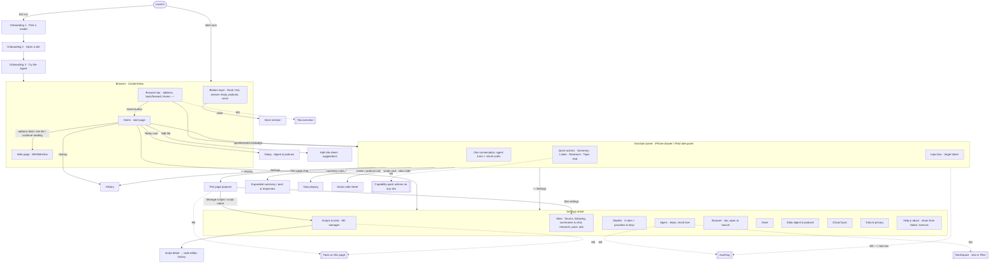

# Unified interface design (whole app)

The unified-interface implementation milestone builds against this page and the design canvas:
**https://claude.ai/artifact/Daefr4AsZcSm2EWbTLU9uK**. The canvas has the information architecture, the answers to the six directions, artboards for iPhone and iPad in light and dark (the assistant panel on a forum page and on an ordinary page, "This page", Home, Settings, the three onboarding steps), motion storyboards, the migration list and the glossary.

It answers section 3 of [next-phase.md](next-phase.md), which wins where [requirements.md](requirements.md) or [README.md](README.md) disagree. It builds on [design-m1.md](design-m1.md) and [design-m2.md](design-m2.md) and their canvases. **This changes structure, not looks.** Every piece keeps Forumind's style: SF text styles, `DCTheme` tokens, `dcCard`, `DCPill`, `DCActionButtonStyle`, `Form(.grouped)`, `SettingsIcon`, `DCMotion` (`Forumind/DesignSystem.swift`, `Forumind/SettingsPanel.swift`). `agentTint` still marks agent and script things and `brandBlue` is still the action colour. Summary keeps `summaryTint` and topic chat keeps `chatTint`. One token assignment changes, and it is listed as a proposal below: Research moves from `agentTint` to `brandBlue`, so purple means only the Agent. If the owner declines, Research keeps `agentTint` and nothing else changes.

**What the boards draw that is not to be built as copy:**
- **Placeholders.** Dashed, dimmed rows marked M3, M4 or M5 only show where a later milestone's screen goes. The implementation ships no disabled rows: each milestone adds its own row in the place shown.
- **Captions.** Notes that explain a board sit in the canvas's sticky notes, not inside the mock UI.

**Two rules from the owner, for every screen:**
- **Menus are native menus only.** A SwiftUI `Menu` (`UIMenu`) holds only these: buttons (a title, an SF Symbol and an optional subtitle), checkmark or toggle state, submenus, inline sections and dividers, the destructive role, and the small or medium palette sizes. It never holds custom views, switches, sliders, chips, badges or text fields. Here is where each of this design's menus stands:
  - The model pill is a `Menu` of models with a checkmark on the current one, plus "Models…".
  - The panel's ⋯ and the summary card's ⋯ hold buttons only. Export options… opens its sheet.
  - The iPhone browser menu and the iPad More menu hold buttons only.
  - Follow, the script switches and "Block ads here" are real `Toggle`s, so they live in the This page **popover**, never in a menu.
  - The tile actions on Home (Pin, Unpin, Remove) are a `contextMenu` of buttons.
- **The UI explains itself.** Labels stay short. Layout, icons and state carry the meaning. No line of copy explains how the screen works:
  - When a page has no quick actions, the row is simply absent.
  - Settings rows carry no explanatory footers beyond what Forumind's existing pages already have.
  - Onboarding keeps one short subtitle per step.
  Designer notes live in this file and in the canvas's sticky notes, outside the frames.

**Status: a draft for the owner.** Nothing here is built until the owner confirms the information architecture, the artboards and the migration list. M2's UI tasks finish to their current design. Moving them is part of this design's implementation, and no M2 screen is redrawn here. Screens the cleanup deletes (consent, terms, report, moderation) need no migration and are only listed.

## The six directions, answered

1. **One assistant, one input box.** One panel (`AssistantPanel`) with one composer on every page, sending to the Agent by default. Summary, Listen (the podcast) and Research (was "Ask the forum") stop being modes. They become **quick actions**: a row of chips right above the input box, shown only when the page supports them. Topic chat, which section 3 doesn't mention, becomes a quick action too. Every result lands in **one conversation**:
   - **Summary** and **Listen** run at once. Summary adds a summary card. Listen starts the podcast and shows the existing now-playing row.
   - **Research** and **Topic chat** need a question. Tapping one puts a **target token** in the input box ("Research ×"). The next message goes to that engine, and the token stays for follow-ups until you remove it or leave the site. Without a token, a message goes to the Agent.
   - The engines don't change. Summary uses `ModelRole.assistant` and the summary pipeline, Topic chat uses the chat engine, Research uses `AgentEngine` (renamed `ResearchEngine` later, see the glossary), and the Agent uses `BrowserAgent`.
2. **Capabilities follow the page.** The M1 context row's chip ("N scripts on this page") becomes the **This page** chip. It shows the site's kind and what the page can do ("Forum · 3 scripts"). It opens the **This page** popover (`PageCapabilitiesView`, which grows from M2's `PageScriptsPopover`). The popover has four groups:
   - **What you can do here**: quick actions and Follow.
   - **Scripts on this page**: M2's rows and switches.
   - **Tools on this page**: an M5 placeholder.
   - **This site**: block ads here, and a link to the site's settings.
   It is the only place a page's capabilities are listed. The toolbar badge keeps its M1/M2 meaning (the script count) and opens the panel.
3. **Home is the browser's start page.** From top to bottom:
   - an address field ("Search or enter address");
   - Today, only when the digest or podcast has something;
   - **Sites**: a grid of pinned and frequent sites, with an Add tile;
   - **Recent tasks**: agent conversations and research runs;
   - Continue reading;
   - Following.
   Forums are tiles like any site, with a small purple sparkle badge meaning "this site has extra capabilities". Suggested forums move into the Add site sheet.
4. **Settings grouped by object.** The root has five groups:
   - **Assistant**: Models, Agent, Scripts & tools.
   - **Sites & browsing**: Sites, Browser.
   - **Listen & Today**: Voice, Daily digest & podcast.
   - **Your data**: iCloud Sync, Data & privacy.
   - **Help & about**.
   All three model roles are on one Models page. Every setting appears exactly once (the per-setting table below).
5. **One vocabulary.** Only the browser agent is called **Agent**. Site-wide Q&A is called **Research**. Script, tool and site mean one thing each in the UI, the docs and the code (glossary below).
6. **Onboarding in three steps.** 1 Pick a model, 2 Open a site, 3 Try the Agent. After that you're done. Welcome, Forums, Daily, Privacy and Done fold into these steps or move to Settings.

**Proposals beyond section 3, for the owner to confirm:**
- **Topic chat becomes a quick action** rather than being merged into the Agent. The Agent sees only the DOM page, while chat has the whole thread through the adapter. A later milestone (M5/M6) can fold it in.
- **One conversation for all results** instead of one view per mode.
- **"Browser" stays a settings group of its own.** The bar position and what opens at launch fit none of section 3's seven groups.
- **The iPhone bar's forum menu (`ForumMenuButton`) becomes the browser menu.** It shows the site's icon. "Home" opens the start page, and the forum-only items move (migration list).
- **The ad shield moves from the title capsule into This page.**
- **"Watch" is renamed "Follow"** (next-phase's word).
- **Research takes `brandBlue` instead of `agentTint`** (see above).
- **On iPad, onboarding steps 1 and 2 are a form sheet** instead of today's full-screen cover.

## Information architecture



Dashed links with double borders are **placeholders**: their place is reserved, and their content comes in the milestone named.

| Placeholder | Milestone | Where it sits | What is reserved now |
|---|---|---|---|
| Multiple tabs | M3 | A tab button in the browser bar, beside Home, opening a tab overview | The bar's slot. The panel works on the active tab |
| Audit log | M3 | Settings › Agent › Audit log; the panel's ⋯ › Audit log; "View in audit log" in an expanded tool row | One row on the Agent page, drawn disabled |
| Workspace | M3 | Settings › Agent › Workspace (and the system Files app) | One row on the Agent page, drawn disabled |
| Page tool list | M5 | This page › Tools on this page; Settings › Scripts & tools › Tools; script detail "Registers N tools" | The group's place in This page (drawn dashed on the canvas; nothing shipped until M5) |
| Capability quick actions | M6 | The quick-action row, on any site whose page tools return a thread or a post list | Nothing new: the row already shows actions by capability, not by forum |
| `GM_ai` model | M4 | Settings › Models, a fourth role row "Scripts" ("Same as Agent") | A disabled row on Models |
| Confirm before writes, step-limit switches | M3 | Settings › Agent | The Agent page's "Safety" section |

## Areas and their SwiftUI structure

### 1. Assistant panel

One view for both hosts. On iPhone it lives in the existing drawer (`AIDrawer.swift`, `.medium/.large` detents, background interaction up to medium). On iPad it lives in the existing split panel (`WorkspaceView` in `SplitWorkspace.swift`, 360 to 560 pt). Neither host changes.

```
AssistantPanel                         // replaces the per-mode switch in SummaryPanel/AgentPanel/BrowserAgentPanelView
├─ AssistantHeader                     // "Agent" · model pill (role follows the target) · ⋯ menu
│    ⋯: New conversation, History, Audit log (M3, disabled), Settings
├─ PageContextRow                      // host DCPill + This page chip → PageCapabilitiesView (.popover, compact adaptation .popover)
├─ AssistantTranscript (ScrollView)    // one list, newest at the bottom (scrollToBottomEdge)
│    ├─ user bubble / agent text / tool rows / "Steps N" fold   (M1, unchanged)
│    ├─ ScriptCard                                              (M1/M2, unchanged)
│    ├─ SummaryResultCard   dcCard(tint: summaryTint) · covers N posts · ⤢ opens ExpandedPanel
│    ├─ ResearchResultCard  dcCard(tint: brandBlue) · answer with numbered sources · "N topics read" fold
│    ├─ TopicChatTurn       bubbles with a chatTint "Topic chat" caption
│    └─ ListenRow           PodcastNowPlayingRow
└─ AssistantFooter (dcStickyFooter)
     ├─ status line                    // M1 status line; for Research: "Researching · 4 of 12 steps"
     ├─ QuickActionBar                 // horizontal chips, hidden when empty
     └─ Composer                       // AskBox field + target token + send / Stop
```

- **State.** Replace `AssistantMode` (`summary`, `chat`, `agent`, `browserAgent`) with two small types:
  - `AssistantTarget` (`.agent`, `.research`, `.topicChat`) for where the composer sends.
  - `QuickAction` (`.summary`, `.listen`, `.research`, `.topicChat`), whose availability comes from `SiteCapabilities` for the current page (M6: also from page tools).
  `app.assistantMode` becomes `app.assistantTarget`, and its default is `.agent` on every page.
- **The transcript** is a UI list of entries that point into each engine's own state (`BrowserAgentSession`, the summary store, the chat stream, the `AgentEngine` run). No engine merges. A Summary or Research result for a topic is the same record History shows, so reopening the panel on that topic shows it again.
- **What one conversation covers.** The Agent's turns belong to the browser (one conversation now, one per tab from M3) and stay as you move between pages, as `BrowserAgentSession` does today. Quick-action results belong to their topic or forum and show only while you are on it. ⋯ › New conversation clears the Agent's turns and the target token. Results stay in History.
- **Page states.** Today's panel has page states besides the modes (`AssistantPanel.BodyKind` in `SummaryPanel.swift`):
  - `forumHome` (`ForumHomeState`) becomes the forum-list chips below.
  - `notForum` (`NotForumState`) goes: an ordinary page shows the Agent with no chips.
  - `maybe` (`MaybeForumState`, with its "add this forum" button) becomes a row in This page › This site: "Add as a forum".
  - `loading` (`AssistantLoadingState`) stays as the transcript's loading row.
- **Quick actions per page** (drawn):

  | Page | Chips |
  |---|---|
  | Forum topic (Discourse, WordPress post, HN item) | Summary · Listen · Research · Topic chat |
  | Forum home or list | Summary (of the list, as today) · Research |
  | Any other page | none; the row is hidden (M6 adds chips when page tools allow) |
  | No model for a chip's role | The chip stays. A tap shows `ProviderSetupCard` for that role in the transcript |
- **Chip look.** A chip is a 36 pt capsule with a 44 pt hit area and `.subheadline.weight(.medium)`. It carries its tint at 12 % with the tint as text, and a symbol: Summary `text.alignleft`, Listen `headphones`, Research `sparkle.magnifyingglass`, Topic chat `bubble.left.and.bubble.right`. A chip whose result already exists reads "Summary · updated" or "Summary · 12 new".
- **The target token.** It is a `DCPill` inside the field's leading edge, with the target's tint, its symbol and an ✕. The placeholder changes to "Research talk.example.org…" or "Ask about this topic…". The model pill shows that role's model while the token is set.
- **The panel's old tabs:**
  - Post & responses (`ExpandedPanelRoute.post`) is reached from a summary card's citations and ⤢, unchanged.
  - History (`.history`) is ⋯ › History.
  - Settings (`.settings`) is ⋯ › Settings, opening Settings at the root.
- **Today's ⋯ menu, item by item** (`SummaryPanel.swift`):

  | Today | Where it lands |
  |---|---|
  | Summary, Chat, Ask the forum, Agent (mode switches) | Quick-action chips |
  | History, Settings | The panel's ⋯ |
  | Clear chat | The Topic chat turn's ⋯ › Clear topic chat. ⋯ › New conversation for the Agent |
  | Copy, Share, Export .txt, Export options…, Instructions & context, Pull post + replies only, Post & responses | The summary card's ⋯ menu |
  | Watch topic / Unwatch topic | This page › Follow this topic |
  | Report this answer / summary | Deleted by the cleanup |
- **Voice** still starts from the voice button in the browser bar and in the composer (`VoiceBarButton`), as today. The voice Dock replaces the bar while a session runs.
- **Accessibility.** The chips are a group, "Quick actions", where each chip is a button. The token reads "Research, remove". The identifiers `agentPanel` and `aiButton` stay. New ones: `quickActionBar`, `quickAction.summary`, `composerTargetToken`, `pageCapabilitiesChip`.

### 2. This page (`PageCapabilitiesView`)

This is a `.popover` with `.presentationCompactAdaptation(.popover)`, 320 to 340 pt, as M2's popover. It opens from the panel's chip.

```
PageCapabilitiesView
├─ header: site icon · host · kind DCPill ("Forum · Discourse" in agentTint, or "Website" in secondary) · page URL (mono, middle-truncated)
├─ Section "What you can do here"    // only for forums: Summary ✓, Listen ✓, Research ✓, Follow this topic (Toggle)
├─ Section "Scripts on this page"     // M2 PageScriptsPopover rows, Turn on box, Manage scripts — unchanged
├─ Section "Tools on this page"       // M5: the place only; not shipped before M5
└─ Section "This site"                // Block ads here (Toggle; was AdShieldMenu) · Add as a forum (was MaybeForumState) · Site settings ›
```

The chip reads "Forum · 3 scripts" or "3 scripts" (an ordinary page), or just the host on a page with nothing else; it stays a button, because the site group always has something. Errors keep M2's danger form ("3 scripts · 1 error").

### 3. Home (start page)

```
HomeView (List, .insetGrouped, listSectionSpacing(.compact))
├─ header: "Home" · History · Settings      (unchanged buttons)
├─ AddressField                              // 44 pt capsule, "Search or enter address"; focus shows suggestions (sites, history)
├─ TodayModule / PodcastHomeCard / DigestStrip   // unchanged, only when there is something
├─ Section "Sites": SiteGrid                 // LazyVGrid, 4 columns on iPhone, adaptive 88 pt on iPad
│    SiteTile: ForumIcon-style tile (DCTheme.forumTileIcon), name; forum → small agentTint sparkle badge
│    pinned first, then most visited; last tile "Add" → AddSiteSheet; context menu Pin/Unpin, Remove
├─ Section "Recent tasks": RecentTaskRow     // agent conversations + research runs: first words, host, time → page + panel
├─ Section "Continue reading": ContinueReadingRow   // unchanged, any site, keeps NewRepliesBadge
└─ Section "Following"                        // watched topics with new replies (was Watching)
```

- **Recent tasks** today shows Research runs and summaries from History. Agent conversations live in memory (`BrowserAgentSession`). They join the list once they are saved, which comes naturally with M3's workspace (`tasks/`). Until then, the section shows the last agent conversation of this launch.
- **The empty state** (no sites yet) is the address field plus a `dcCard`: three suggested sites, no explanatory text. The forums among them carry the sparkle badge. This replaces the forum-centred empty state and the suggestions section.

### 4. Settings

The settings sheet keeps its host (`RootPresentation.settings(page)`, its own `NavigationStack`, Done only on the root).

```
SettingsRootView (Form .grouped)
├─ Section "Assistant"
│    Models            cpu            value: "3 roles" or "Agent: none"
│    Agent             sparkles       agentTint
│    Scripts & tools   curlybraces    agentTint, value: N / Off     (M2's row moves here)
├─ Section "Sites & browsing"
│    Sites             globe          value: "N forums"
│    Browser           safari.fill    value: "Bar: Automatic"
├─ Section "Listen & Today"
│    Voice             waveform       value: On / Off               (the top-of-root Voice row goes)
│    Daily digest & podcast  sun.max.fill   value: On / Off
├─ Section "Your data"
│    iCloud Sync · Data & privacy
└─ Section
     Help & about      (Share from Safari or Chrome and Licences move inside)
```

| Page | Contents |
|---|---|
| **Models** (`SettingsPage.models`, was `.provider`) | Section "Default models", with one row per role: **Agent** (`ModelRole.browserAgent`, tool-calling models only), **Summaries & chat** (`.assistant`), **Research** (`.agent`), then a disabled **Scripts** row (M4 `GM_ai`, "Same as Agent"). Section "Answer language": `ReadingLanguagePicker` (moved from the root). Section "Providers & keys": the existing provider list and forms |
| **Agent** (`.agent`, now the browser agent only) | Section "Runs": Step limit, Result size (from the old Ask-the-forum page's "Browser agent" section). Section "Safety": Confirm before writes. Requirements section 7 lists it, it isn't built yet, and the tools it guards (`http_request`, `cookies_get`) arrive in M3, so it lands then. Section "Records": Audit log ›, Workspace › (M3). Header line: the model name with a Change link to Models |
| **Scripts & tools** (`.scripts`) | M2's `ScriptManagerView`, unchanged. M5 adds a "Tools" section |
| **Sites** (`.sites`, new) | Section "Forums": Forums › (the existing page), Following › (the existing Watched topics page). Section "What forums can do": Summaries & chat › (the existing page, minus pacing), Research › (the research half of the old `.agent` page). Section "Reading pace": the rate-limit switch (cleanup task 1) and the existing pace picker. Section "Ads & trackers": `ContentBlockingSettingsSections` (moved from Browser) |
| **Browser** (`.browser`) | Browser bar position, Open at launch. Nothing else |
| **Voice**, **Daily digest & podcast**, **iCloud Sync**, **Data & privacy** | Unchanged pages |
| **Help & about** (`.help`) | The existing page, which already links Licences (`.acknowledgements`), plus a row to Share from Safari or Chrome (`.sharing`, today on the root) |

### 5. Onboarding (`OnboardingFlow`, three steps)

Today onboarding is a full-screen cover on both devices (`RootPresentation.isFullScreen`). Steps 1 and 2 keep it on iPhone. On iPad they become a form sheet over the browser (a proposal). Step 3 runs in the real browser after the cover or sheet closes: the page opens with the panel at medium in a first-run state. `OnboardingProgressDots` shows 3.

```
OnboardingFlow
├─ 1 OnboardingModelPage     // BrandMark, "An agent for any web page"; OnboardingProviderPage's list for the Agent role
│                            // (tool-calling models only), key field; footnote "Keys stay in the Keychain"; Continue / Later
├─ 2 OnboardingSitePage      // AddressField + suggested sites (forums with the sparkle badge, from ForumDirectory) ; Open
└─ 3 OnboardingTryPage       // the chosen page behind a medium drawer: the real AssistantPanel with two suggested prompts
                             // ("Make this page easier to read", "Hide everything but the article"); after a run or Skip:
                             // a dcCard "You're set" with Done, and rows "iCloud sync: On" and "Daily digest: in Settings"
```

"Later" on step 1 still goes on. Step 3 then shows the panel's no-model card instead of the prompts.

### 6. Motion

Motion explains what happened, so the screens need fewer words. It reuses what the app already has:
- `DCMotion.quick` (0.22 s), `.smooth` (0.32 s) and `.spring` for animation.
- `DCMotion.respecting(reduceMotion, …)` for Reduce Motion.
- `DCHaptics` for haptics.
- `.contentTransition(.numericText())`, already used on Home.
- The zoom navigation transition, already used by Now playing.
- The Dock's `glassEffectID` morph.

There are no new curves and no decorative motion. Every animation is short, starts from what was touched, and ends where the result is. The canvas's **Motion** board draws each one as a storyboard.

| Moment | What moves | How (SwiftUI) | Why |
|---|---|---|---|
| Tap Research or Topic chat | The chip flies into the input box and becomes the target token. The field's placeholder crossfades. Tapping the token's ✕ sends it back to the row | `matchedGeometryEffect(id: action, in: ns)` shared by the chip and the token, `DCMotion.spring`, `DCHaptics.tap()` | It shows where the next message goes, with no explanation needed |
| Tap Summary or Listen | The chip shows a small `ProgressView` in place of its symbol. The result card then inserts at the bottom of the conversation, which scrolls to it | `.transition(.move(edge: .bottom).combined(with: .opacity))`, `DCMotion.smooth`, the existing `scrollToBottomEdge` | It links the tap to its result |
| Page changes (forum topic ↔ ordinary page) | The quick-action row grows or collapses in height while its chips fade. The header and input box stay still | `.transition(.opacity.combined(with: .scale(scale: 0.96, anchor: .bottom)))` on the row, `DCMotion.smooth` | Only the part that differs moves, so the panel reads as the same panel |
| This page chip and toolbar badge | The count rolls to its new value. The chip's tint crossfades to danger on an error | `.contentTransition(.numericText())`, `DCMotion.quick` | Shows that a script just applied or failed |
| Open This page | The system popover animation, nothing custom | `.popover` | Native behaviour |
| Agent running | Unchanged from M1: tool rows slide in, `ResearchRing` turns around the toolbar button, and the run folds into "Steps N" when it ends. Research runs get the same ring | M1's `DCMotion.respecting` rules | One way to show "working" |
| Run finishes | A success haptic, and the status line's dot morphs into the check. With the panel closed, the existing button bounce plays and the Dock shows "Answer ready" (`glassEffectID` morph) | `DCHaptics.success()`, `.symbolEffect(.bounce)` | Felt even when you aren't looking |
| Run fails or hits the step limit | A warning haptic. The card inserts as above and is announced | `DCHaptics.warning()`, the M1 announcement | Same rule for every result |
| Home: open a site tile or a recent task | The tile zooms into the page. A recent task then raises the panel | `.navigationTransition(.zoom(sourceID: site.id, in: ns))`, the Now playing pattern. If the browser host can't take a navigation transition, a 0.22 s crossfade | Keeps your place: back returns to the tile |
| Home: pin or unpin | The tile moves to or from the front of the grid | `withAnimation(DCMotion.spring)` on the grid order | Shows where it went |
| Onboarding | Steps 1 → 2 push. The active progress dot stretches to the next one. When the cover closes for step 3, the panel rises to medium over the opened page and the two prompts appear 60 ms apart | `matchedGeometryEffect` on the active dot, the drawer's own detent animation, a `.delay` on the second prompt | Ends onboarding inside the real app, not on a "done" page |
| Settings | System push and pop only | — | Settings stay plain |

**Reduce Motion.** Every row above goes through `DCMotion.respecting`:
- Moves, scales, zooms and the chip-to-token flight become a 0.2 s opacity crossfade.
- The progress ring and the bounce are off.
- Number rolls become plain changes.
- Haptics stay, because they aren't motion.

## Migration list

Kinds: **keep** (same place, maybe new words), **move** (same view, new place), **merge** (folded into another screen), **delete** (gone; own proposals are flagged *owner*), **cleanup** (deleted by the cleanup milestone, no migration).

### Browser shell, bar and Dock

| Existing | Kind | Where it lands |
|---|---|---|
| `ContentView`, `BrowserContent`, `PhoneBrowser` | keep | Unchanged hosts |
| `PhoneTitleCapsule` | keep | Shows the host. The `.notForum` warning is already gone (M1) |
| `PhoneAIButton`, `SplitPanelToggle`, `ResearchRing` | keep | Opens the one panel. The badge is M1/M2's |
| `VoiceBarButton`, `VoiceDock`, `VoiceSessionBar`, `VoiceBarCloseButton`, `VoiceLevelBars`, `VoiceDisclosure` | keep | Voice starts from the bar and the composer, as today |
| `AdShieldMenu` | move | This page › This site › Block ads here |
| `ForumMenuButton` (iPhone bar menu) | keep | Renamed browser menu, showing the site icon. Items: **Home** (was "Home", the forums home) opens the start page; the site's own home, Back, Forward, Stop/Reload, Share page, Copy link, History and Settings stay; Report or block goes with the cleanup. *owner* |
| `ForumSwitcherPanel` | delete | Not used by any view today. Home's Sites grid covers pinned and recent sites |
| `SplitNavigationButtons` | keep | Unchanged |
| `SplitMoreMenu` (iPad ⋯) | keep | Items: All forums → **Home**; Add forum… → **Add site…**; History, Settings, Translate posts on screen stay; Report or block goes with the cleanup |
| `DockLayer`, `HomeRouteDockModifier` (`Dock.swift`) | keep | The bottom layer's views, unchanged |
| `BottomLayer` `.bar`, `.dock` (voice), `.barWithPodcast`, `.drawer` | keep | Unchanged |
| `BottomLayer.barWithAnswerReady` | keep | Says "Answer ready" for any panel result (agent done, research answer, summary) |
| `BottomLayer.barWithHint` + `DrawerHint` `.summarize` | keep | New words: "Summary is ready to try · Open assistant" |
| `DrawerHint` `.checkNew`, `.setUpAI` | keep | `.setUpAI` reads "Choose a model" |
| `DrawerHint` `.allowAI` | cleanup | Goes with AI data consent |
| `WebContentCrashBanner`, `LoadingLine`, `LoginReadinessView` (`.loginInfo`) | keep | Unchanged |

### Assistant panel

| Existing | Kind | Where it lands |
|---|---|---|
| `AssistantMode` (`summary`, `chat`, `agent`, `browserAgent`) and the mode menu | merge | `AssistantTarget` + `QuickAction` (section 1) |
| `AssistantPanel` (`SummaryPanel.swift`) | keep | The one panel. Its per-mode branches go |
| Summary mode view | merge | The Summary quick action → `SummaryResultCard` in the transcript; ⤢ → `ExpandedPanel` |
| Chat mode | merge | The Topic chat quick action + target token. *owner* (section 3 is silent on chat) |
| Ask the forum (`AgentPanel.swift`, `AssistantMode.agent`) | merge | The Research quick action + token. The run shows as `ResearchResultCard` with its steps fold (`toolStrip` and `stepRow` reused) |
| `BrowserAgentPanelView` | merge | The Agent part of the transcript (M1 rows, cards, status line, composer) |
| Panel tabs `ExpandedPanelRoute` `.post` / `.history` / `.settings` | move | `.post`: from summary cards. `.history`: ⋯ › History. `.settings`: ⋯ › Settings |
| `ExpandedPanel` (`RootPresentation.expanded`) | keep | Opened from ⤢ |
| `ResultCardsOverlay` (`.research`, `.sources`, `.focus`, `.search`) | keep | Same overlay over the page. Its research tint follows Research's |
| `ProviderSetupCard`, `ProviderSetupSheet` (`.providerSetup(role)`) | keep | Shown for the target's or chip's role |
| `InstructionsSheet` (`.instructions`), `ExportOptionsSheet` (`.exportOptions`) | keep | Under the summary card's ⋯ |
| `PostsTranslationSheet` (`.translatePosts`), `TranslationSheet` (`.translateText`) | keep | Unchanged triggers |
| `ReadAloudButton` | keep | On summary cards |
| M1 script card, View code sheet | keep | Unchanged |
| M1 context row chip "N scripts on this page" | merge | The This page chip |
| M2 `PageScriptsPopover` | merge | The "Scripts on this page" group inside `PageCapabilitiesView`, unchanged rows |

### Home and its sheets

| Existing | Kind | Where it lands |
|---|---|---|
| `HomeView` header (History, Settings) | keep | Unchanged |
| `TodayModule`, `PodcastHomeCard`, `DigestStrip` | keep | Below the address field, only when there is something |
| Continue reading (`ContinueReadingRow`, `NewRepliesBadge`) | keep | Any site |
| Pinned forums section | merge | The Sites grid (pinned first) |
| Recent forums section | merge | The Sites grid (frequent) |
| Watching section | keep | Renamed "Following" |
| Suggested forums section | move | `AddSiteSheet` (was `AddForumSheet`, `.addForum`), and the empty state |
| Share card | move | Help & about › Share from Safari or Chrome |
| `.pinnedForums` (all forums sheet), `ForumDirectory` | move | Settings › Sites › Forums |
| `.shareHowTo` (`ShareHowToSheet`) | keep | Opened from Help & about |
| `HistoryView` | keep | Segments: All, Summaries & chats, **Research** (was Asks), **Following** (was Watching) |
| `TodayPage`, `DigestHistoryPage`, `DigestCardView` | keep | Unchanged, from Home's Today card |
| `NowPlayingView` (`.nowPlaying`) | keep | Unchanged |

### Settings, page by page

| Existing `SettingsPage` / section | Kind | Where it lands |
|---|---|---|
| Root: the Voice row at the top | delete | It duplicated Listen & Today › Voice |
| Root: `ReadingLanguagePicker` | move | Models › Answer language |
| `.provider` "AI models" | move | **Models** (`.models`), with all three roles |
| `.summaries` batching, chat context, custom instructions | move | Sites › What forums can do › Summaries & chat |
| `.summaries` `ForumRequestPaceSection` | move | Sites › Reading pace (plus the cleanup's on/off switch) |
| `.agent` research steps, topics to read, read size | move | Sites › What forums can do › **Research** (`.research`) |
| `.agent` "Browser agent" section (steps, truncation) | move | **Agent** (`.agent`) › Runs |
| `.watched` Watched topics | move | Sites › Forums › **Following** |
| `.forums` | move | Sites › Forums |
| `.digest` (incl. `SettingsPodcastSections`) | keep | Listen & Today |
| `.voice` | keep | Listen & Today |
| `.browser` bar position, start page | keep | Browser |
| `.browser` `ContentBlockingSettingsSections` (ads, trackers, allowed sites) | move | Sites › Ads & trackers |
| `.sync`, `.data` | keep | Your data |
| `.help` | keep | Help & about |
| `.sharing` (a row on the root today) | move | A row inside Help & about |
| `.acknowledgements` | keep | Already linked from Help & about |
| `.scripts` (M2 `ScriptManagerView`, `ScriptDetailView`, `ScriptCodeEditor`, `ScriptHistoryView`) | move | Assistant › **Scripts & tools**. Only the root row moves; the pages are unchanged |
| `.debugSettings` | keep | Unchanged (DEBUG) |
| `ModelListSheet` (`.openAIModels`) | keep | From Models |

### Onboarding

| Existing | Kind | Where it lands |
|---|---|---|
| `OnboardingFlow` (`RootPresentation.onboarding`), `OnboardingPage`, `OnboardingHeader`, `OnboardingProgressDots`, `OnboardingBackdrop` | keep | Three steps |
| `OnboardingWelcomePage` | merge | Step 1's header |
| `OnboardingProviderPage` | keep | Step 1, for the Agent role |
| `OnboardingForumsPage`, `OnboardingForumIcon` | merge | Step 2 (any site; forums get the badge) |
| `OnboardingDailyPage` | move | Settings › Daily digest & podcast (no step) |
| `OnboardingSyncCard`, `OnboardingDoneSyncRow` | merge | Step 3's "You're set" card |
| `OnboardingDonePage`, `ChecklistMark` | merge | Step 3's "You're set" card |
| `OnboardingPrivacyPage`, `PrivacyPoints` | cleanup | Goes with consent. Step 1 keeps the one line about keys |
| `ShareHowToGuide` | move | Help & about |

### Deleted by the cleanup (no migration)

`.termsGate`, `.aiConsent` (`AIDataConsentViews`), `.voiceConsent` (`VoiceConsentSheet`), `.podcastConsent` (`PodcastConsentSheet`), `.report` (`ReportSheet`), `.reportAIOutput` (`AIOutputReportSheet`), and the rest of `ModerationViews` / moderation UI. "Content blocking" in next-phase's kind 1 means moderation's content filtering. The ad and tracker blocker (`ContentBlocker`) stays and moves to Sites (section 3 lists ad blocking under Sites).

## Glossary

One word per thing, the same in the UI, docs and code. Code renames happen in the unified-interface implementation unless marked. Stored raw values stay, so saved settings need no migration.

| Word (UI) | Means | Not called | Code |
|---|---|---|---|
| **Agent** | The browser agent: one loop with tools that reads and changes web pages. The only thing called Agent | browser agent (in the UI), assistant | `BrowserAgent`, `ToolRegistry`. `ModelRole.browserAgent` → `.agent` (raw value stays `"browserAgent"`) |
| **Research** | Answers a question by searching and reading the whole site, with numbered sources. Forums only (M6 may widen it) | Ask the forum, site-wide Q&A, research agent, Agent | `AgentEngine` → `ResearchEngine`, `AgentPanel` → `ResearchRunView`, `AgentToolName` → `ResearchToolName`, `AgentLimits` → `ResearchLimits`, `ModelRole.agent` → `.research` (raw value stays `"agent"`), `SettingsPage.agent`'s research half → `.research`. The VoiceOver label "Agent" for this mode (`AssistantStates.swift`) goes |
| **Assistant** (the panel) | The one panel beside the page: the conversation, quick actions and the input box. The header says "Agent", because that is where you type | AI drawer, mode | `AssistantPanel`. The drawer and split hosts keep their names |
| **Quick action** | A one-tap chip above the input box, shown only when the page supports it | mode | `QuickAction` |
| **Summary** | A structured summary of the open topic | | unchanged |
| **Topic chat** | Questions about the open topic, answered from its full text | Chat (alone) | the chat engine; `AssistantTarget.topicChat` |
| **Listen** | The podcast of the open topic or of Today | | podcast views, unchanged |
| **Voice** | The live voice conversation | | unchanged |
| **Follow** | Get told when a topic has new replies | Watch | `watchedTopics` (rename optional, stored data unchanged) |
| **Site** | Any website | | — |
| **Forum** | A site with a built-in adapter (Discourse, WordPress, Hacker News), so it has extra capabilities. Marked with the sparkle badge | | `SiteAdapter`, `Forum` |
| **This page** | What the current page can do: quick actions, scripts, tools, site switches | page info | `PageCapabilitiesView` |
| **Script** | Saved JavaScript/CSS in ScriptStore that runs on matching pages. It changes the page (M2) or registers tools (M5) | userscript (only in export/import), extension | `ScriptStore` |
| **Tool** | A function the Agent can call. Comes from the app (built-in), a script (script tool) or the site (site tool, WebMCP). "Page tools" means script and site tools on the current page | action, command | `ToolRegistry`; source prefixes per next-phase section 4 |
| **Task** | One conversation with the Agent, from the first message to the last result | session, job | `BrowserAgentSession` |
| **Home** | The browser's start page | | `HomeView` |
| **Workspace** (M3) | The Agent's file folder, visible in Files | | — |
| **Audit log** (M3) | The record of every tool call | history | — |
| **History** | Saved summaries, topic chats and research runs | | `HistoryView` |

## Checks before implementing

- **Every setting appears once.** Every current settings page has one destination. Pages that move whole keep all their sections, and the pages that split (`.agent`, `.summaries`, `.browser`, the root) are listed section by section.
- **The same panel everywhere.** Opening the panel on a forum topic and on an ordinary page shows the same header, chip and input box. Only the quick-action row differs (artboards 1 and 2).
- **Order.** Implementation goes assistant panel, then settings, then home and onboarding (next-phase section 5). Each part ships alone.

## Appendix: every other view in the code

Every public `struct …: View` / `ViewModifier` under `Forumind/` is named on this page. The ones the tables above don't name:

| Views | Kind | Where they land |
|---|---|---|
| `SettingsProviderPage`, `ProviderSettingsPage`, `ModelRolePage`, `ModelRoleRow`, `ProviderSetupForm`, `ProviderMenu`, `ProviderBadge`, `ProviderTestStatusView`, `APIKeyField`, `ModelField`, `AppleIntelligenceStatusView` | move | Settings › Models |
| `SettingsAgentPage` | merge | Split: research half → Sites › Research; browser-agent half → Agent |
| `SettingsSummariesPage` | move | Sites › Summaries & chat (pacing → Sites › Reading pace) |
| `SettingsWatchedPage` | move | Sites › Following |
| `SettingsForumsPage`, `PinnedForumsEditor`, `ForumRow`, `ForumTile`, `ForumTileLabel`, `ForumSwitcherLabel` | move | Sites › Forums (tiles reused by Home's Sites grid) |
| `SettingsBrowserPage` | keep | Browser, minus ads & trackers |
| `SettingsDigestPage`, `PodcastTodaySection`, `PodcastDisclosure`, `DigestIcon` | keep | Listen & Today |
| `SettingsVoicePage` | keep | Listen & Today › Voice |
| `SettingsSyncPage`, `SettingsSyncRow`, `SyncStatusRow`, `SettingsDataPage` | keep | Your data |
| `SettingsHelpPage`, `SettingsAcknowledgementsPage`, `SettingsSharingPage`, `ShareStepRow`, `ShareSheetIllustration`, `ShareActionsIllustration` | keep | Help & about |
| `SettingsDestination`, `SettingsIconRow`, `SettingsRowLabel`, `SettingsStatusPill` | keep | Settings building blocks |
| `AgentView` (`AgentPanel.swift`) | merge | Research run view inside the research card |
| `ForumHomeState`, `NotForumState`, `MaybeForumState`, `AssistantLoadingState` | merge | Page states, section 1 |
| `AssistantForumIcon`, `AssistantForumPill`, `AssistantForumRow`, `AssistantProgressBar`, `WorkProgressBar`, `WorkProgressCard`, `TypingIndicator`, `DrawerStatusRow`, `DrawerSummarySections`, `ChatBubble`, `PostPreviewView` | keep | Travel with the summary card, research card and topic chat turns |
| `AIDrawerModifier`, `AIDrawerCoordinator`, `PanelResizeHandle`, `DebugWindowWidth`, `RouterHost`, `HomeDestinations` | keep | Hosts and routing, unchanged |
| `OnboardingFeatureRow`, `OnboardingIconTile` | keep | Onboarding building blocks |
| `MarkdownView`, `MarkdownBlockView`, `CitationChip`, `TranslateButton`, `NewRepliesDot`, `BrandAppIcon`, `BrandGlyphLayout`, `BrandGlyphShape`, `DCCardModifier`, `DCSectionHeader`, `DCStatusChip` | keep | Shared components and the design system, unchanged |
| `AIDataConsentPage`, `AIDataFlowSection`, `TermsGateView`, `TermsAgreementCard`, `TermsPoints`, `ReportForm`, `ReportEmailFallback`, `ModerationSettingsSections`, `BlockedUsersPage`, `FilteredWordsPage` | cleanup | Deleted with consent, terms and moderation |

Private and file-private helper views travel with the screen that defines them.
