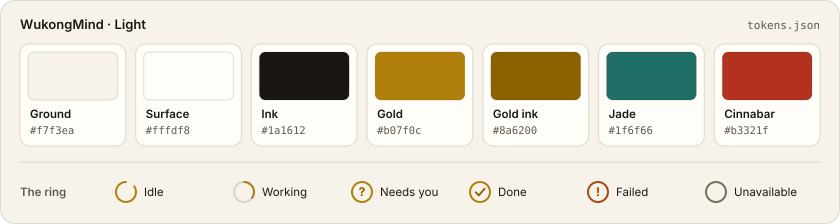
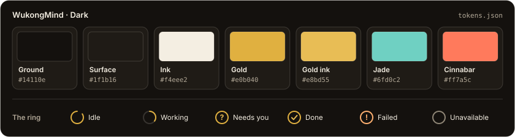

# WukongMind

WukongMind (悟空) is a browser for iPhone and iPad where you just ask: one input box on every page, one Agent behind it. This is its design system. It replaces the look inherited from Forumind (blue-to-purple gradient, capsule pills, multicoloured tiles) with ink, gold and a single ring.

The name comes from the Monkey King, whose mark is the gold band he wears. The band is the system's one signature shape, and its colours come from ink painting: ink, gold leaf, jade and a cinnabar seal.

## Designed with care

WukongMind replaces gradients and noisy chrome with four ink-painting colours — **Ink** on warm paper or lacquer black, **Gold** for the Agent and its ring, **Jade** for website content, and **Cinnabar** only for stop and errors. Typography uses system fonts only (**SF Pro**, **PingFang SC**, and **SF Mono** for code), scaled with iOS Dynamic Type and framed by subtle hairlines.

  

  

## Content fundamentals

- **Just ask.** The interface offers sentences, not features. Suggestions read as things a person would say: "Summarize this post and replies", "Make it dark".
- **Short and plain.** The Agent says what it is doing, then what happened. "Let me see how this site is laid out first. About half a minute." "Saved. Faster next time."
- **Failure is said, not shown.** When something can't be done the Agent explains it in a sentence or two in the conversation. There are no greyed-out features to decode.
- **One word per thing.** Agent, script, tool, site, forum, suggestion. Sentence case everywhere; no exclamation marks.
- The app is bilingual. Chinese copy follows the same rules: 短句，直说，不用感叹号。

## Visual foundations

### Four colours, four meanings

| Colour | Token | Means | Where |
| --- | --- | --- | --- |
| 墨 Ink | `ink`, `ground`, `surface` | Structure and reading | Text, seals, icon tiles, the page |
| 金 Gold | `gold`, `gold-ink`, `gold-wash` | The Agent and the one primary action | The ring, send, primary button, switch, running state, "saved" |
| 青 Jade | `jade`, `jade-wash` | Content that came from a website | Result card headers, citation numbers, source links |
| 朱 Cinnabar | `cinnabar`, `danger` | Stop, delete, error | Stop button, destructive actions, error text |

Rules that follow:

- Gold is the only brand colour in the interface. There are no gradients anywhere.
- Text on a `gold` fill is always `on-gold` (dark). White on gold fails contrast and is never used.
- Gold as text or icon on a light surface is `gold-ink`, never `gold`.
- Cinnabar inside the app only ever means stop or wrong. "New" and "unread" are gold seals. Cinnabar as a brand colour appears only on the cover and the app icon.
- A state is always an icon plus a word; colour never carries it alone. `success` and `warning` exist for that pairing.
- Light theme sits on warm paper (`ground`), dark theme on lacquer black. Neither uses pure white or pure black for surfaces.

### The ring

The gold band is drawn as a circle with a gold stroke and nothing inside.

- It is the Agent's button in the browser bar, and it says what the Agent is doing. One function maps what the app already knows to one of six states, and every ring draws that state:

  | State | Still picture | Motion | Word (accessibility value) |
  | --- | --- | --- | --- |
  | idle | open `gold` ring | none | none |
  | working | `gold` arc on a `hairline` track | turns, 1.1 s a turn | "Working" |
  | needs you | `gold` ring with a `gold-ink` question mark | none | "Needs your answer" |
  | done | closed `gold` ring with a `gold-ink` check | once: the gap closes in 250 ms, then the check | "Answer ready" |
  | failed | ring and exclamation mark in `warning` | none | "Stopped with a problem" |
  | unavailable | `ink-faint` ring | none | none; the button loses its button trait |

  The bar ring and the iPad panel toggle show all six. The collapsed pill, the folded step header and the tool row show working only. One ring turns per surface: while the panel is visible, the bar ring shows its still state and the panel's tool row turns. "Saved" (the saved note, the Learn on ask card, the key row) reuses the done transition on a 14pt ring, after the event really happened. A state is never carried by colour or motion alone: each has its own shape and its word.
- It is the composer's button: open ring with a mic when empty, filled gold to send, cinnabar to stop.
- It is the running state of a tool: an open gold ring that turns.
- It is the focus indicator (`ring-width` in `gold-ink`).

Only ring things (those buttons and switches) and the glass browser bar and its collapsed pill are round or capsule-shaped (`radius-full` / `height ÷ 2`). Everything else is a rounded rectangle.

### Shape

- Chips, badges and labels are **seals**: squared, `radius-sm`. No capsules on seals, chips or buttons.
- Buttons, fields and suggestion chips are `radius-md`.
- Cards and list sections are `radius-lg`.
- The **browser bar** and its collapsed pill are the one capsule exception (`radius = height ÷ 2`, in glass; see [BrowserBar](components/BrowserBar/README.md) and [design-browser-bar-tabs-models.md](../../design-browser-bar-tabs-models.md)).
- Edges are hairlines, not shadows. Shadows exist only for things that float: the assistant panel (`shadow-panel`) and popovers and the bar (`shadow-pop`).

### Type

System fonts only: SF Pro for Latin, PingFang SC for Chinese, SF Mono for code. Every style maps to an iOS text style so Dynamic Type works; the pixel sizes in the tokens are the default-size values. Monospace marks machine things: tool names, match rules, code, token counts.

### Spacing

A 4pt base: `space-1` 4, `space-2` 8, `space-3` 12, `space-4` 16, `space-6` 24, `space-8` 32. Screen margins are `space-4`. Touch targets are at least 44pt.

## Iconography

- SF Symbols in the app, outline weight, drawn in `ink` unless they sit on a fill. The previews here use equivalent stroke icons.
- Icons are not colour-coded by kind. A tool's icon is ink; only its state has colour.
- The Agent has no icon other than the ring. Do not use a sparkle for it.
- There is no logo file yet. Where a mark is needed, use the ring in `gold` on `ground` and set the name in the `large-title` style.

## Moving from Forumind's DesignSystem.swift

| Forumind (`DCTheme`) | WukongMind token | Note |
| --- | --- | --- |
| `brandBlue`, `brandGradient` | `gold` (fills), `gold-ink` (text) | No gradient. Text on gold is `on-gold` |
| `brandPurple`, `agentTint` | `gold`, `gold-ink`, `gold-wash` | The Agent is gold |
| `summaryTint`, `citationText`, `chatTint` | `jade`, `jade-wash` | One colour for site content |
| `danger` | `cinnabar` / `danger` | Same role |
| `success`, `warning` | `success`, `warning` | New values, same roles |
| `pageBackground`, `surface`, `raisedSurface` (system grouped colours) | `ground`, `surface`, `surface-raised` | Now the system's own warm values |
| `border` | `hairline`; `border-strong` for control edges | |
| `newRepliesBadge*` | gold seal (`gold-wash`, `gold-ink`) | |
| `cardCornerRadius` 18, `controlCornerRadius` 12 | `radius-lg` 14, `radius-md` 10 | |
| `DCPill` (capsule) | Seal (`radius-sm`) | |
| `forumPalette` (8 tile colours) | unchanged | Site tiles keep their own colours |
| `spacingXS` … `spacingXXL` | `space-1` … `space-8` | Same values |

## Components

Button, Composer, SuggestionRow, Message, ToolRow, ResultCard, ScriptCard, BrowserBar, Seal, Switch, ListRow. Each has a live preview and guidelines. They are reference drawings in HTML; the app implements them in SwiftUI.

## Accessibility

- Every text and icon colour pairs with the grounds named in its token note at 4.5:1 or better, in both themes; control edges and the ring at 3:1.
- `ink-faint` is for `ground` and `surface` only.
- Honour Increase Contrast by switching `hairline` to `border-strong`.
- Motion shows a live signal or a cause, never decoration. Continuous motion is allowed only where it displays something happening now: the turning ring (the Agent is working), the voice level meter (sound in or out), the composer's recording pulse (the microphone is on), and progress (the app's progress bar and the system's own spinner). The ring also has one one-shot: its gap closes into the check when work is done or saved. Short functional transitions are allowed when they explain cause and effect: a suggestion moving into the input box, a new result rising into the conversation, the browser bar morphing between its expanded bar and collapsed pill, Home appearing over the page (a fade within 200 ms), and standard sheet transitions. Keep each within 250 ms with no bounce. Decorative motion is not allowed: no rolling counts, zooming tiles, bounces, parallax, launch animations or pulsing placeholders. Every state is also a still picture and a word. With Reduce Motion on, transitions become a fade (a 0.2 s cross-fade at `p > 0.6` / `p < 0.4` for the browser bar) and continuous motion stands still, except that a progress bar with no known value keeps a slow opacity pulse so a long job never looks frozen.
